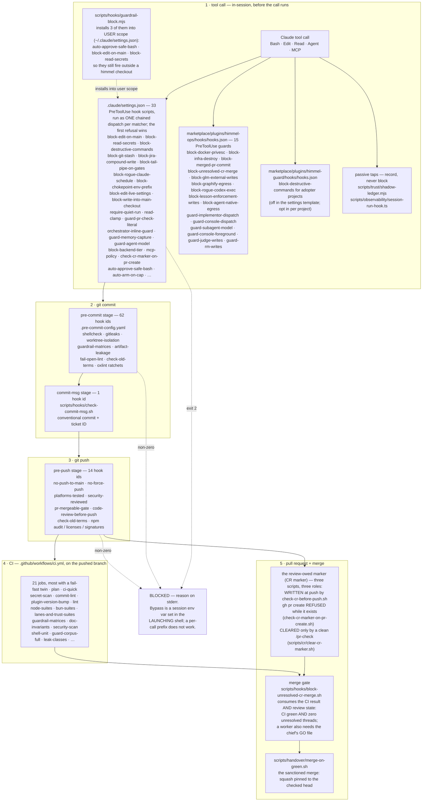
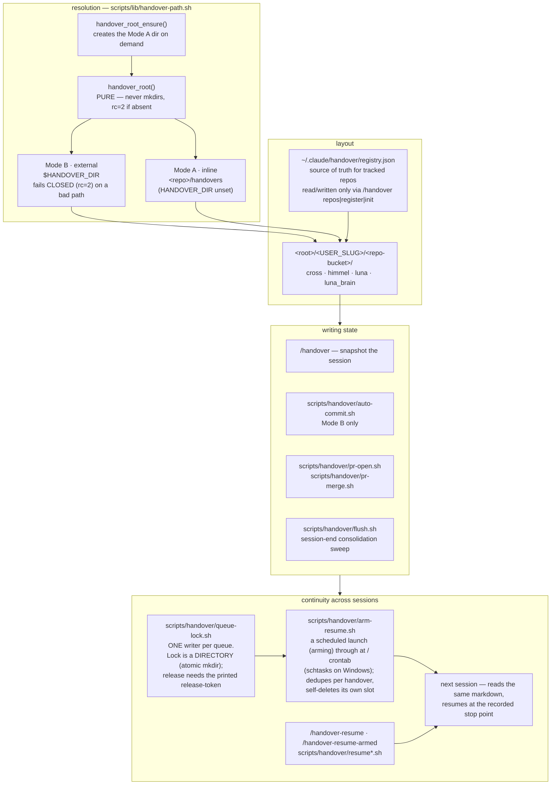
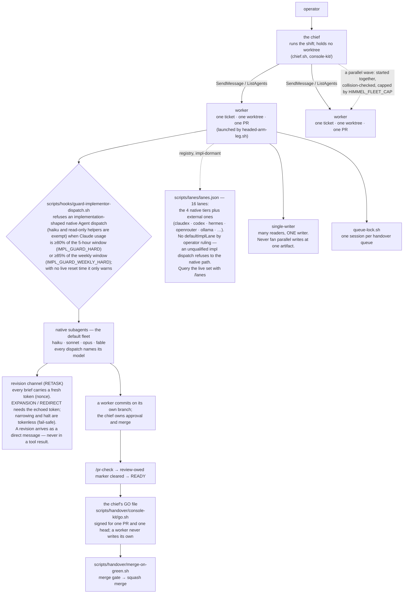
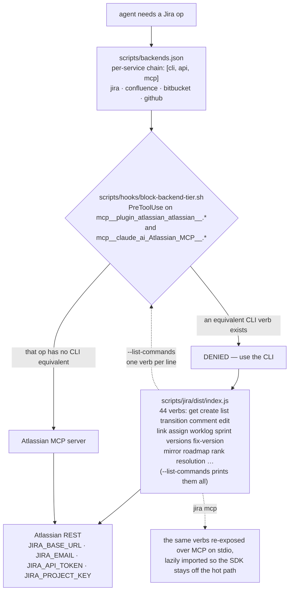
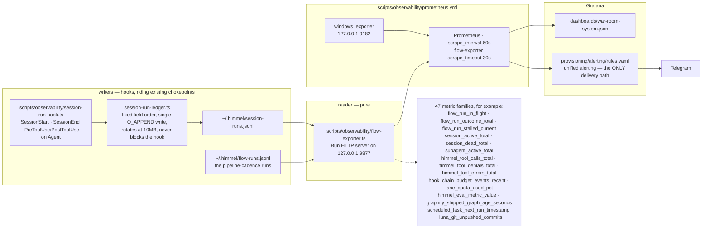

# himmel architecture — the diagrams

Five views of how the harness is wired. For the narrative version (what the
parts are, how one ticket moves through them and why it is built this way),
start with [`system-design.md`](system-design.md).

A box that names a repo path points at a file you can open and read. The one
exception is `scripts/jira/dist/index.js`, a generated build artifact that only
exists after a build (see "Keeping these accurate" below). The diagrams also contain actor and external-system boxes
(`Claude tool call`, `operator`, `Prometheus`, `Telegram`, `Atlassian REST`,
…) that deliberately name no file.

Words follow the [glossary](glossary.md): the **chief** is the session that
runs a shift, and each **worker** owns one ticket, one worktree and one pull
request. Many identifiers still carry the older names until their rename slice
lands (HIMMEL-5689). The chief's command and script are already `/chief` and
`chief.sh`, but its directories and markers say `console` (`console-kit/`,
`HIMMEL_CONSOLE_*`), and a worker's say `leg` (`headed-arm-leg.sh`,
`HIMMEL_CONSOLE_LEG`). A box shows the new word first and the identifier as it
is today.

These are the structural views. Four **behavioural** chains already have
diagrams in [`configuration.md`](configuration.md) and are not repeated here:
the ticket→ship chain, the tool-call permission chain, the Telegram bridge
router, and the delegation-lane routing tree. Read those for "what happens to
one call"; read this file for "what the layer is made of". The development
graph ([`guide/dev-graph.html`](guide/dev-graph.html), drawn from
[`guide/dev-graph/graph.json`](guide/dev-graph/graph.json)) shows every
decision a change meets on its way from dispatch to merge.

- [1. The enforcement layers](#1-the-enforcement-layers)
- [2. The handover system](#2-the-handover-system)
- [3. The fleet: the chief and its workers](#3-the-fleet-the-chief-and-its-workers)
- [4. The Jira / backend seam](#4-the-jira--backend-seam)
- [5. The observability chain](#5-the-observability-chain)

---

## 1. The enforcement layers

himmel enforces structurally, at five independent stages. A rule that lives at
only one stage can be forgotten; the same invariant is often checked at two.
The live inventory is `.claude/settings.json`, the plugin `hooks.json` files,
and `.pre-commit-config.yaml`; this diagram shows the shape, not the list.

**Why five stages and not one.** Each stage sees something the others cannot. A
PreToolUse hook sees the *intent* of a single call but not the diff. A
pre-commit gate sees the staged diff but not the branch's history. A pre-push
gate sees the whole range and the remote. CI sees a clean machine. The merge
gate sees the CI result plus review state, which is why it comes last and why
the arrow runs CI → merge gate and never the reverse. An invariant that matters
gets checked wherever it is cheapest to catch, and the ones that matter most
get checked twice.

**What a starter install carries.** An adopter project gets a small subset:
the three user-facing guards (`auto-approve-safe-bash`, `block-edit-on-main`,
`block-read-secrets`) wired into its own `.claude/settings.json`, and — when it
has no `.pre-commit-config.yaml` — three native git gates placed by
`scripts/adopt.sh` (`check-worktree-isolation.sh`, `check-commit-msg.sh`,
`check-push-target.sh`). The rest of this diagram runs from a himmel checkout.

Per-hook behaviour, the guardrail matrix, and the bypass env var for each:
[`internals/enforcement.md`](internals/enforcement.md). Recovery when one
stops you: [`internals/stuck-playbook.md`](internals/stuck-playbook.md).

---

## 2. The handover system

Handover is how work survives a session boundary. State is plain markdown in a
directory the resolver picks; nothing about it is opaque or lossy.

**The invariant that makes it work.** One worker is one file: state and orders
never split across two documents, so a resuming session cannot read half the
picture. The queue lock is structural rather than advisory because prose
coordination between two armed sessions failed three ways in one night. The
escalation is recorded in `scripts/handover/queue-lock.sh`'s own header.

Full flows and the resolver contract:
[`internals/handover-system.md`](internals/handover-system.md).

---

## 3. The fleet: the chief and its workers

More than one Claude session runs at a time. The fleet model says who may
write what, who may spawn whom, and how a revision reaches a running agent.
The chief starts its workers in parallel waves; a dependency chain is a set of
workers that must run in order, because each needs the one before it to merge.

**Caps that are not model-tuned.** Spawn depth and concurrency come from
`CLAUDE_CODE_MAX_SUBAGENT_SPAWN_DEPTH` and
`CLAUDE_CODE_MAX_CONCURRENT_SUBAGENTS`, so read the environment; unset means
the harness default applies. Haiku does not spawn.

Every decision a change meets between dispatch and merge — the usage check,
the fleet cap, the review-round cap, the ready-check, the judge, the GO file —
is drawn in the development graph
([`guide/dev-graph.html`](guide/dev-graph.html)); the local dashboard shows the
same graph on its Workflow page. Tier semantics, effort-before-tier, and cost:
[`internals/lane-calibration.md`](internals/lane-calibration.md). The revision
channel's threat model: [`internals/retask-channel.md`](internals/retask-channel.md).
Native subagents vs. external lane workers:
[`internals/worker-spawn-matrix.md`](internals/worker-spawn-matrix.md).

---

## 4. The Jira / backend seam

An MCP server costs context on every session that loads it. A local CLI costs
nothing until it is called. himmel routes issue-tracker work to the CLI and
keeps MCP for the individual ops a backend's CLI does not implement. A hook
enforces that routing, so Claude does not have to remember it.

**The gate asks the CLI.** It keeps no hand-maintained list of blocked MCP
tools; it asks the CLI what verbs it has. Adding a verb tightens the gate
automatically; removing one loosens it. `block-backend-tier.sh` generalised the
older Jira-only `block-mcp-when-plugin-exists.sh` to the services in
`scripts/backends.json` that have an MCP prefix: Jira and Confluence. GitHub and
Bitbucket are registered there with no MCP prefix, so this gate does not route
them. The older script is no longer wired as a hook.

Invocation shape (absolute path from the primary checkout, because `dist/` is
an untracked build artifact and a worktree lacks it) and the full op ↔ MCP
mapping: [`internals/jira-plugin.md`](internals/jira-plugin.md).

---

## 5. The observability chain

The stack is local, passive, and read-only. The exporter never writes a
ledger, never mutates the vault, never starts or kills a process. Missing data
stays missing rather than being invented.

**The record that never gets written is the important one.** `SessionEnd` is a
graceful-exit hook: a crash, an OOM, or a window the operator eventually closes
emits `session_start` and no `session_end`, ever. So the *reader* decides
liveness, from transcript mtime; the writer does not assert it. The same
reasoning splits an expired unpaired row into `abandoned` (its pid is confirmed
dead: real hygiene information, but nothing is hung and nobody can act, so it
must not page) and `stalled` (everything else).

`alerts.rules.yml` is loaded into Prometheus for self-visibility and
`promtool` testability only; no Alertmanager is installed, so nothing there is
ever delivered. Details and the passivity invariant:
[`../scripts/observability/README.md`](../scripts/observability/README.md).

---

## Keeping these accurate

When you move or rename a file a box above names, this file is part of
the change, the same rule that governs
[`commands-catalog.md`](commands-catalog.md). Every count here is derivable:
the hook scripts per surface from the `PreToolUse` arrays of
`.claude/settings.json` (33 unique scripts) and the himmel-ops `hooks.json`
(15); the gate ids and their split across the three git stages (62
pre-commit, 14 pre-push, 1 commit-msg) from `.pre-commit-config.yaml`; the job
count from `.github/workflows/ci.yml` (21 jobs, not counting the `fail-fast-*`
twins); the lane count from `scripts/lanes/lanes.json`; the verb count from
`node scripts/jira/dist/index.js --list-commands` (44 verbs plus `mcp`); the
metric families from the `addFamily` calls in
`scripts/observability/flow-exporter.ts`. Re-derive rather than trust them if
a diagram and the code disagree.
