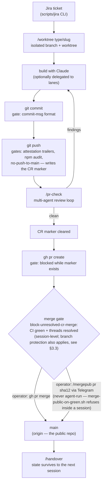
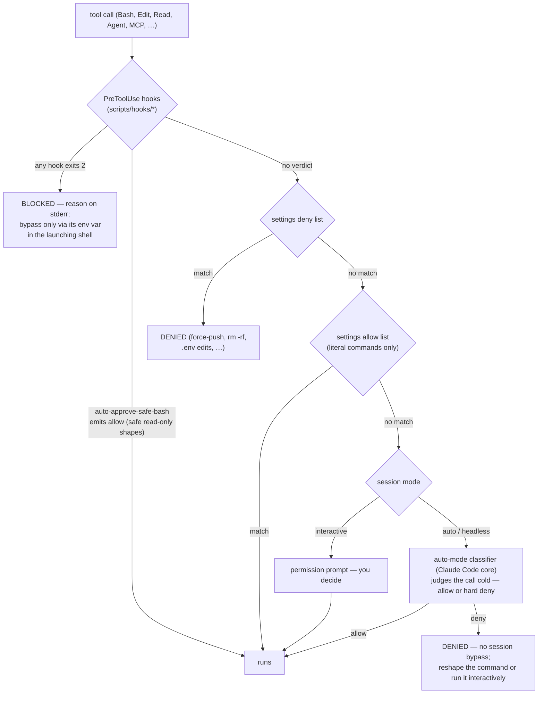
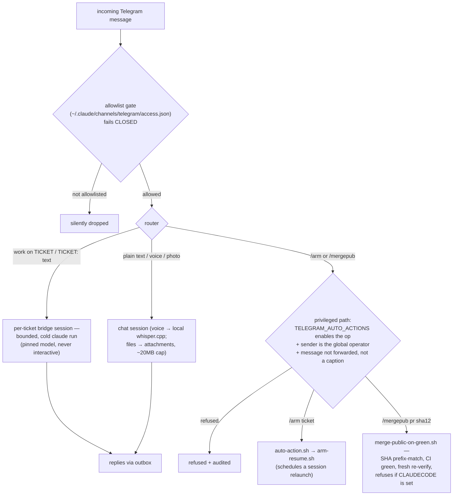
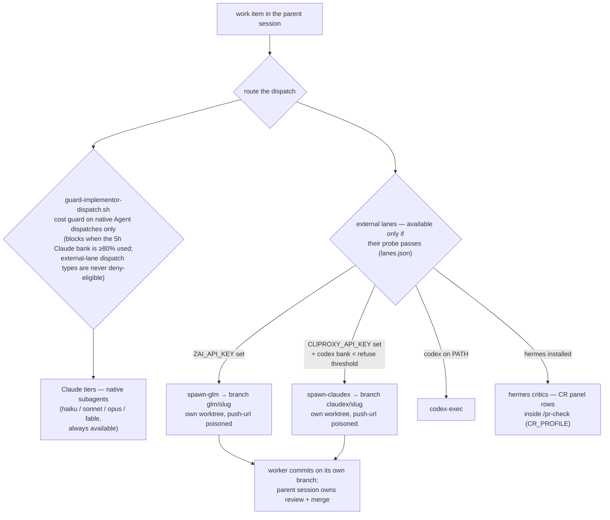

# Configuration & workflow chains

Audience: contributor, and an adopter who has finished getting started. Owner of the rewrite: HIMMEL-7212.

The canonical map of **what himmel does, in what order, and what you can
control**. Every claim here is traceable to code or config in this repo — the
file that enforces or reads each knob is named inline. Per-subsystem depth
lives in the [deep-dive docs](#6-deep-dive-index); this doc is the one place
that shows the whole control surface at once.

Start from [getting-started.md](getting-started.md); [README.md](../README.md)
has the pitch, this doc has the controls. To change one thing, go straight to
[Change one setting](#change-one-setting).

**Contents**

- [Change one setting](#change-one-setting) — the setting groups: plugins, review, auto-ship, scheduled jobs, commit rules, session switches, install answers

1. [What himmel is](#1-what-himmel-is)
2. [The chains](#2-the-chains) — delivery, gate decision, Telegram, lanes
3. [The gates](#3-the-gates) — every veto, classified HARD / auth-gated / warn-only
4. [The control surface](#4-the-control-surface) — every knob, by surface
5. [Off-switches](#5-off-switches) — how to disable each layer
6. [Deep-dive index](#6-deep-dive-index)

---

## Change one setting

Find the group for what you want to change, then the row. Each row says where
the setting lives (its scope and the file or command that stores it), when it
takes effect, how to confirm it did, how to undo it, and which file in this
repo reads it. Paths are relative to the himmel checkout. A `.env` row means
the `.env` at the root of the repo's primary checkout (copy
[`.env.example`](../.env.example)); "bridged" means the reader loads that key
from `.env` itself, while a value exported in the launching shell still wins.
Which loader reads which `.env` keys is in
[`.env` consumer boundaries](#env-consumer-boundaries); the numbered sections
after this one are the full map.

### Plugins

| Setting | Scope · store | Takes effect | Verify | Reverse | Read by |
|---|---|---|---|---|---|
| Plugin profile, `lean` or `full` | user · `enabledPlugins` in `~/.claude/settings.json`, set with `/profile lean` or `/profile full` | next Claude session | `/profile list` | `/profile lean` | `scripts/machine-setup/plugin-profile.sh` |
| One on-demand plugin | user · `~/.claude/settings.json`, set with `/profile enable <spec>` | next Claude session | `/profile list` shows it enabled | `/profile disable <spec>` | `scripts/machine-setup/plugin-profile.sh` |
| Keep or drop one plugin across every reconcile | user · `enabledPlugins` in `~/.claude/settings.local.json` | next reconcile, then the next session | `bash scripts/machine-setup/reconcile-enabled-plugins.sh --dry-run` disables nothing you listed `true` | delete the entry | `scripts/machine-setup/reconcile-enabled-plugins.sh` |
| Enforce the lean floor on every update | machine · `export HIMMEL_RECONCILE_PLUGINS=1` in your shell startup file (`~/.bashrc` or `~/.zshrc`) | next `/himmel-update` | the update's plugin-set reconcile step disables off-floor plugins instead of warning | remove the export | `scripts/himmel-update.sh` |

### Review by a second model

| Setting | Scope · store | Takes effect | Verify | Reverse | Read by |
|---|---|---|---|---|---|
| Critic tier: `none` (Claude only, no external spend), `free` or `paid` | repo · `CR_PROFILE=<tier>` in `.env` (bridged) | next `/pr-check` | `bash scripts/cr/critic-panel.sh --check` probes the critics of the selected tier | remove the line (tier `free`) | `scripts/cr/critic-panel.sh` |
| Require at least one non-Claude critic | repo · `CR_REQUIRE_CROSS_MODEL=1` in `.env` (bridged) | next clear of the review-owed marker | a Claude-only review no longer clears the marker | remove the line | `scripts/cr/clear-review-marker.sh` |
| Per-machine reviewer overlay (add, change or drop a reviewer row) | machine · `critics.local.json` in `${HIMMELCTL_CACHE_DIR:-~/.claude/himmel}/`, else the primary checkout's `scripts/cr/` (gitignored) | next `/pr-check` and next merge-gate check | `bash scripts/cr/critic-panel.sh --check`; field rules in [Reviewer modes](#reviewer-modes) | delete the file | `scripts/lib/review-merge-gate.sh` |

### Auto-ship steps

| Setting | Scope · store | Takes effect | Verify | Reverse | Read by |
|---|---|---|---|---|---|
| Steps a session runs unasked at a completion point (for example `execute,prcheck,pr`) | repo · `HIMMEL_INITIATIVE=<steps>` in `.env` (bridged) | next session start | the session opens with `HIMMEL_INITIATIVE is active. Active steps: …` | remove the line; for one repo only, `"env": { "HIMMEL_INITIATIVE": "" }` in its `.claude/settings.json` | `scripts/hooks/inject-initiative.sh` |
| The unattended (AFK) step set | repo · `HIMMEL_AFK=1` plus `HIMMEL_INITIATIVE_AFK=<steps>` in `.env` (bridged) | next session start | the session opens with `HIMMEL_INITIATIVE_AFK is active. Active steps: …` | set `HIMMEL_AFK=0` or remove both lines | `scripts/hooks/inject-initiative.sh` |

The step vocabulary and the AFK step set: **Initiative & autonomy** in
[§4.1](#41-env--the-file-based-config); what can act without you:
[§4.3](#43-autonomy--what-can-act-without-you).

### Scheduled jobs

| Setting | Scope · store | Takes effect | Verify | Reverse | Read by |
|---|---|---|---|---|---|
| Recurring vault cadence (daily harvest and synthesize, weekly health), armed with `bash scripts/luna/pipeline-cadence.sh arm` | machine · the OS scheduler (cron; Task Scheduler on Windows) | the next scheduled slot | `bash scripts/luna/pipeline-cadence.sh status` | `bash scripts/luna/pipeline-cadence.sh disarm` | `scripts/luna/pipeline-cadence.sh` |
| Cap watchdog that arms a resume before the usage cap (on by default) | session · `AUTO_ARM_DISABLE=1` in the shell that launches `claude` | sessions launched from that shell | `env` in that shell shows `AUTO_ARM_DISABLE=1` | launch `claude` without it | `scripts/hooks/auto-arm-on-cap.sh` |

### Commit rules

| Setting | Scope · store | Takes effect | Verify | Reverse | Read by |
|---|---|---|---|---|---|
| Require a ticket ID in every commit subject (on by default) | machine · `TICKET_ID_REQUIRED=0` in `~/.himmel/himmel.conf` (older installs: the repo's `.env`), or a `TICKET_ID_REQUIRED=0 git commit …` prefix | next commit | a commit with no ticket reference is accepted | remove the line | `scripts/hooks/check-commit-msg.sh` |
| Your own ticket ID shape | machine · `TICKET_ID_PATTERN=<extended regex>` in `~/.himmel/himmel.conf` (older installs: the repo's `.env`) | next commit | a subject without a match is refused, one with a match passes | remove the line (back to `<KEY>-<number>`, or `#<number>` with no `JIRA_PROJECT_KEY`) | `scripts/hooks/check-commit-msg.sh` |
| Ticket tracker: `jira`, `local` or `none` | repo · `git config himmel.tracker <tracker>` | next command that asks the resolver | `/himmel-doctor` row `C55-project-mode` | `git config --unset himmel.tracker` (back to detection) | `scripts/lib/project-mode.sh` |
| Allow edits on the default branch in a single-writer repo | checkout · a `.single-writer` file at the repo root (gitignored) | next edit | an edit on `main` proceeds | delete the file | `scripts/hooks/block-edit-on-main.sh` |

More tracker and forge keys: [Tracker and forge](#tracker-and-forge).

### Session switches

These are read by a hook, so they must be set in the shell that **launches**
`claude`; a prefix on a command inside the session never reaches the hook.

| Setting | Scope · store | Takes effect | Verify | Reverse | Read by |
|---|---|---|---|---|---|
| A deliberate one-off edit on the default branch | session · `EDIT_ON_MAIN_OK=1 claude` | that session | an edit on `main` proceeds | quit and relaunch without it | `scripts/hooks/block-edit-on-main.sh` |
| The update-available nudge at session start | session · `UPDATE_CHECK_DISABLE=1 claude` | that session | no update line at session start | launch without it | `scripts/hooks/check-update-available.sh` |
| Skip writing the review-owed marker for one push | one push · `SKIP_CR=1 git push` (a git gate, so a per-command prefix works) | that push | no review-owed marker is written | push without it | `scripts/hooks/check-cr-before-push.sh` |

Every off switch, by layer: [§5](#5-off-switches).

### Install answers

The installer records your answers in
`${HIMMELCTL_CACHE_DIR:-~/.claude/himmel}/install-profile.json`, and the
updater reads them back.

| Setting | Scope · store | Takes effect | Verify | Reverse | Read by |
|---|---|---|---|---|---|
| Release channel: `stable` or `pre` | machine · `channel` in `install-profile.json` (a new install records `stable`) | next update | `bash scripts/himmel-update.sh --check` reports the channel's newest tag | delete the `channel` key (plain `git pull --ff-only`) | `scripts/himmel-update.sh` |
| Release channel for one run | session · `HIMMEL_UPDATE_CHANNEL=stable` or `=pre` before the command | that run | `--check` reports the channel's newest tag | omit it | `scripts/himmel-update.sh` |
| Installation scope: `project` or `user` | machine · `node scripts/himmelctl/bin.js scope set <project\|user>` (`--dry-run` previews) | when the command finishes | `node scripts/himmelctl/bin.js scope get` | `scope set` to the other value | `scripts/himmelctl/bin.js` |
| Your handle | machine · `USER_SLUG=<kebab-case>` in `.env` (bridged) | next handover or worktree command | new handover files land under your handle | remove the line (back to a slug of `git config user.name`) | `scripts/lib/user-slug.sh` |

Release channel detail: [updating.md](setup/updating.md#release-channels).

---

## 1. What himmel is

himmel runs Claude Code as a **managed, PR-gated agent**. Instead of trusting
the model to remember rules, it enforces the workflow *structurally*, at three
layers:

- **git hooks** (`.pre-commit-config.yaml` — pre-commit, commit-msg, pre-push)
  gate what can be committed and pushed: secrets scanning, conventional
  commits, worktree isolation, attestation trailers (commit-message lines —
  `Platforms tested:` / `Security reviewed:` — asserting you actually tested
  and reviewed; [§3.1](#31-git-gates-pre-commit--commit-msg--pre-push)), and
  a mandatory automated review before a PR.
- **Claude Code hooks** (`.claude/settings.json` → `scripts/hooks/`) gate what
  a live session can do at the tool-call layer: no edits on `main`, no secret
  reads, no PR creation while a review is owed, no merging over unresolved
  review threads.
- **Sanctioned scripts** own the dangerous transitions: auto-merge
  (`scripts/handover/merge-on-green.sh`), human-authorized merge
  (`scripts/merge-public-on-green.sh` — human-authorized only, via Telegram).

Everything above the guardrails is **opt-in autonomy**: initiative mode
(`HIMMEL_INITIATIVE`) makes a session drive finished work toward shipping;
arming (`scripts/handover/arm-resume.sh`) schedules a session to relaunch;
AFK (unattended) mode dispatches whole tickets; the Telegram bridge lets
you drive all of it from your phone. Each of those layers is OFF until you
turn it on — with one exception: the usage-cap watchdog ships enabled with
the hooks (kill switch `AUTO_ARM_DISABLE=1`) — and every layer has an off
switch ([§5](#5-off-switches)).

## 2. The chains

### 2.1 The delivery chain, end to end

One piece of work travels: ticket → worktree → build → review loop → PR →
merge → handover. himmel is a single repo (`origin`, public since the
cutover) — there is no propagation tail.



Step-by-step, with the enforcing file:

| Step | Command / trigger | What gates it |
|---|---|---|
| Branch | `/worktree <type>/<slug>` | branch must be `type/slug`; refuses branches with a merged PR (`scripts/_new-worktree.sh`) |
| Edit | any Edit/Write | `scripts/hooks/block-edit-on-main.sh` — must be in a worktree, never `main` |
| Commit | `git commit` | conventional-commit format (`scripts/hooks/check-commit-msg.sh`); pre-commit stage: gitleaks, shellcheck, lockfile/artifact checks (`.pre-commit-config.yaml`) |
| Push | `git push` | pre-push stage: attestation trailers, npm audit, no-push-to-main, and `scripts/hooks/check-cr-before-push.sh` writes a **review-owed marker** recording that a review is owed |
| Review | `/pr-check` | multi-agent panel (`.claude/commands/pr-check.md`); a clean result clears the marker |
| Open PR | `gh pr create` | `scripts/hooks/check-cr-marker-on-pr-create.sh` blocks while the marker exists |
| Merge | `gh pr merge`, or Telegram `/mergepub <pr> <sha12>` (`merge-public-on-green.sh`); armed auto-merge (`merge-on-green.sh`, `ARMAUTOMERGE=1`) admits a confirmed-private repo, or the ONE configured public origin under live-verified branch protection — `enforce_admins` enabled and required status checks present | `scripts/hooks/block-unresolved-cr-merge.sh` — CI green + zero unresolved review threads. Branch protection is also active on `main` (required status checks, squash-only + 1 approving review + code-owner review, `enforce_admins`, no force-push/deletion); this hook is one gate among several, not the whole gate |
| Handover | `/handover` | state written to your handover store (`docs/internals/handover-system.md`) |

### 2.2 What happens on every tool call

Every tool call a session makes passes through the same decision funnel.
Bypass env vars for these **Claude Code hooks** are session-level: set in the
shell that *launches* `claude` (e.g. `EDIT_ON_MAIN_OK=1 claude`) — a per-call
`VAR=1 cmd` prefix does not reach the hooks. (The **git-hook** bypasses in
[§3.1](#31-git-gates-pre-commit--commit-msg--pre-push) are different: git
hooks run in your own shell, so there a per-command prefix like
`SKIP_CR=1 git push` works — and is preferable, since it scopes the bypass to
one push instead of a whole session.)



Two structural notes, both from code:

- Claude Code's native allow-list matcher refuses to match any Bash command
  containing `$var`, `$(…)`, backticks, or compound operators — such commands
  fall through to the prompt/classifier even when allow-listed.
  `scripts/hooks/auto-approve-safe-bash.sh` exists to close that gap for
  provably safe read-only shapes; it only ever emits *allow*, never blocks.
- A deny rule or an exit-2 hook always wins over a hook's allow (per Claude
  Code's precedence rules, restated in
  `scripts/hooks/auto-approve-safe-bash.sh`'s own header). The
  auto-mode classifier is effectively a HARD gate in headless/auto sessions
  (there is no bypass; himmel's mitigation is routing sanctioned commands
  around it, e.g. `scripts/hooks/block-jira-compound-write.sh` bouncing a
  compound Jira write into the one literal shape the gateway can approve).

### 2.3 Remote control — the Telegram bridge

Optional; nothing starts it automatically. One bot token, one poller
(`scripts/telegram/`), an allowlist that **fails closed**, and privileged
commands that are default-OFF. Detail: [telegram-bridge.md](telegram-bridge.md).



Security properties (all in `scripts/telegram/poller.ts` / `gate.ts` /
`auto-action.ts`):

- A non-allowlisted sender is dropped at ingest; allowlisting a **group**
  trusts every member of that group for ordinary chat/dispatch — but `/arm`
  and `/mergepub` additionally require the sender to be the globally
  allowlisted operator.
- Forwarded `/arm`/`/mergepub` messages are refused (injection kill-switch);
  text arriving via media captions or voice transcripts is never
  auto-executed.
- `TELEGRAM_AUTO_ACTIONS` is default-OFF; `merge-public` is *explicit-only* —
  even `TELEGRAM_AUTO_ACTIONS=all` does not enable it; you must name it.
- `/mergepub` is the only *himmel-side* path to a public merge (the operator
  can always use the GitHub UI directly), and the script refuses to run if it
  detects it is inside a Claude session (`CLAUDECODE` env check).

### 2.4 Lane routing & delegation

Work can be delegated: down the Claude tiers (native subagents), or out to
external lanes through sanctioned spawn scripts — GLM (Z.ai's GLM coding models),
claudex/codex (OpenAI Codex-side models via a local proxy), and hermes (a local multi-provider critic/junior runner). The
lane *inventory* is data, not prose: `scripts/lanes/lanes.json` resolved
against machine state by `/lanes` (`scripts/lanes/resolve.mjs`). A "subscription usage budget"
below is a usage-quota window — the rolling 5-hour Claude window, or the
Codex weekly allowance.



**Dormancy (operator ruling 2026-08-19).** The diagram shows what
each sanctioned script *does*, not what is currently routed to it. Every external
impl lane in the registry is marked `dormant`, and `lanes.json` deliberately
carries no `defaultImplLane` — so an unqualified impl dispatch refuses toward
the native Claude-subagent path rather than silently picking a lane. Opting
one in is per-dispatch and per-lane (`GLM_LANE_OK`, `CLAUDEX_LANE_OK` — see
the env table in §4.1). Hermes critic rows inside `/pr-check` are unaffected.
`/lanes` is the live inventory; `internals/lane-calibration.md` is the status
of record.

Key invariants (enforced or structural, not just prose): external workers
commit on their **own** `glm/<slug>` / `claudex/<slug>` branches in isolated
worktrees (shared-branch mode `--branch <existing>` serializes through
`scripts/lib/shared-branch-lock.sh` — single writer); the parent session owns
review and merge; both the GLM and claudex worktrees get their push URL
poisoned as a tripwire (`spawn-glm.ts` / `spawn-claudex.ts`).

## 3. The gates

Classification used throughout (derived from what each script's code does,
not how docs describe it):

- **HARD** — structurally blocks; no in-session bypass (only destructive
  measures like `--no-verify` or deleting the hook).
- **auth-gated** — blocks until explicit authorization satisfies it: an env
  var set in the launching shell, a marker file, a clean `/pr-check`, or an
  operator action from an out-of-band channel.
- **warn-only** — warns, nudges, or injects context; the action proceeds.

### 3.1 git gates (pre-commit · commit-msg · pre-push)

Source of truth: `.pre-commit-config.yaml`. `git push --no-verify` skips the
whole pre-push stage — that is deliberate and visible, not a loophole himmel
tries to close.

| Gate | Stage | Class | Satisfied / bypassed by |
|---|---|---|---|
| `gitleaks` secret scan | pre-commit | HARD | remove/rotate the secret; inline `gitleaks:allow` on the same line |
| `leak-classes` gate (home-path, mac, private-lan-ip, hostname, telegram token — `scripts/guardrails/leak-classes.sh`) | pre-commit (also runs in CI) | HARD | fix the finding; inline `# leak-allow: <class> <reason>` on the same line, or a path prefix in `.leak-classes-ignore` |
| `git-env-scrub` gate — trust-path (`scripts/handover`, `scripts/lanes`, `scripts/hooks`, `scripts/cr`, `scripts/lib/go-gate.sh`) git calls must scrub `GIT_DIR`/`GIT_WORK_TREE`/`GIT_COMMON_DIR`/`GIT_INDEX_FILE` (`scripts/guardrails/check-git-env-scrub.sh`; the helpers scrub git's full `git rev-parse --local-env-vars` list, and the full scan fails on a stale baseline entry) | pre-commit (also runs in CI) | HARD, ratcheted (`scripts/guardrails/git-env-baseline.txt` grandfathers pre-existing hits) | scrub via `scripts/lib/git-clean.sh` / `scripts/lanes/git-clean.mjs`; exempt with a standalone own-line `# git-env-ok: <reason>` comment (shell, file-level) or an inline `// git-env-ok: <reason>` (JS, per-call) |
| `shellcheck` | pre-commit | HARD | fix the script |
| `worktree-isolation`, `merged-branch-check`, `hookspath-misconfig`, `lockfile-integrity`, `artifact-leakage`, `uv-lock-integrity`, `pip-hashes`, `mcp-plugin-refs` | pre-commit | HARD | fix the finding (`--no-verify` only) |
| drift guards (`doc-guard`, `agents-md-fresh`, `lanes-inventory-guard`, `hud-drift`, `telegram-fork-drift`, `template-himmel-plugins`) | pre-commit (most carry no `stages:` pin, so today they fire at every installed stage, push included) | HARD | fix the finding |
| `no-headless-gemini` (billing rule) | pre-commit | HARD | `# headless-gemini-ok: <reason>` marker on/above the line; docs paths exempt (`scripts/hooks/check-no-headless-gemini.sh`) |
| `conventional-commit-msg` — conventional shape + ticket traceability (ON by default; pattern = `TICKET_ID_PATTERN`, else `JIRA_PROJECT_KEY-N`, else `#N`) | commit-msg | HARD | fix the message; `TICKET_ID_REQUIRED=0` opts out of the ticket half; merge/revert and `TICKET_ID_EXEMPT_AUTHORS` exempt (fixup/squash skip shape only) |
| `no-push-to-main` | pre-push | HARD | none — work through a PR |
| `npm-audit` / `npm-licenses` / `npm-audit-signatures` | pre-push | HARD | fix the dependency |
| `no-force-push` | pre-push | HARD for `main`; warn-only elsewhere | `SKIP_FORCE_PUSH_GATE=1` silences the non-main warning only |
| `code-review-before-push` — writes the review-owed marker | pre-push | auth-gated | run `/pr-check` to clean (clears it); `SKIP_CR=1 git push` (per-command) skips writing |
| `platforms-tested` attestation (`Platforms tested: <os>` on shell/script diffs) | pre-push | auth-gated | the trailer in any commit of the push range or the PR body; `[skip platforms-check]`; `PLATFORMS_TESTED_OK=1` (`scripts/hooks/check-platforms-tested.sh`) |
| `security-reviewed` attestation (`Security reviewed: <token>` on non-docs diffs) | pre-push | auth-gated | same shapes: trailer / `[skip security-review]` / `SKIP_SECURITY_REVIEW=1`; docs-only diffs exempt |
| `pr-mergeable-gate` | pre-push | HARD for a locally-proven merge conflict; warn-only otherwise | refuses only a locally-proven merge conflict; `SKIP_PR_MERGEABLE=1` |

> Note on "first commit": CLAUDE.md's convention says attestation trailers
> belong in the FIRST commit after genuinely testing/reviewing. The hooks
> themselves scan the **entire push range** for the trailer — the
> first-commit rule is discipline (attest when you actually did the work),
> not positional enforcement.

### 3.2 Session gates (Claude Code hooks)

Wired in three places: the repo's `.claude/settings.json` (project scope),
`~/.claude/settings.json` (user scope — see
[§4.2](#42-claude-code-settings--hooks)), and the himmel-ops plugin's
`marketplace/plugins/himmel-ops/hooks/hooks.json` (`block-docker-privesc`,
`block-merged-pr-commit`, `block-unresolved-cr-merge`, `block-graphify-egress`,
`block-rogue-codex-exec`, `guard-implementor-dispatch`,
`guard-console-dispatch`
— these seven exist only
where that plugin is installed). All scripts under `scripts/hooks/`. Full
per-hook behavior: [internals/enforcement.md](internals/enforcement.md).

| Hook | Fires on | Class | Bypass (launching shell) |
|---|---|---|---|
| `block-edit-on-main` | Edit/Write on a repo that is on `main`, or in the primary checkout | auth-gated | `EDIT_ON_MAIN_OK=1`; per-repo: a gitignored `.single-writer` file at the repo root |
| `block-read-secrets` | Read/Grep/Bash/PowerShell touching `.env`, keys, credentials | auth-gated | `READ_SECRETS_OK=1` |
| `block-destructive-commands` | recursive `rm`, `schtasks` mutation, `taskkill`, forced git rewrites, `curl\|sh`, … | auth-gated | `DESTRUCTIVE_OK=1` |
| `block-rogue-claude-schedule` | one command that both registers a scheduler job and launches `claude` | auth-gated | `ROGUE_SCHEDULE_OK=1`; or use the sanctioned `arm-resume.sh` / `pipeline-cadence.sh` |
| `block-rogue-codex-exec` | raw native `codex exec` outside the sanctioned dispatch script (no preflight, no pins, no registry, no watchdog) | auth-gated | `CODEX_EXEC_RAW_OK=1` |
| `block-backend-tier` | an MCP (Model Context Protocol plugin-server) call for a service whose CLI ranks higher and has the verb (registry `scripts/backends.json`) | auth-gated | `MCP_ALL_OK=1` or `MCP_<SERVICE>_OK=1` |
| `block-jira-compound-write` | a Jira CLI write wrapped in `$(…)`/heredoc/chain | auth-gated (blocks the compound shape, prescribes the one literal retry) | `JIRA_COMPOUND_WRITE_OK=1` |
| `block-tail-pipe-on-gates` | a pipeline whose FIRST stage invokes an exit-code-critical gate (`check-ci.sh`, `clear-cr-marker.sh`, `run-shell-tests.sh`, `merge-on-green.sh`, `pr-merge.sh`, `scripts/*/test-*.sh`) and whose LAST stage is `tail`/`head` — `$?` would be tail's, not the gate's | warn-only (fail-open on anything it cannot parse) | a same-line `# tail-pipe-ok: <reason>` marker — deliberately NOT an env var, since a per-call prefix never reaches a hook |
| `guard-memory-capture` | writes to the auto-memory store breaking its form rules | auth-gated | `MEMORY_CAPTURE_OK=1` |
| `block-docker-privesc` | privileged/secret-mounting docker runs | auth-gated | `DOCKER_PRIVESC_OK=1` |
| `block-merged-pr-commit` | `git commit` onto a branch whose PR already merged | auth-gated (hygiene) | `MERGED_PR_COMMIT_OK=1` |
| `check-cr-marker-on-pr-create` | `gh pr create` while a review-owed marker exists | auth-gated | clean `/pr-check` (clears the marker) |
| `block-unresolved-cr-merge` | `gh pr merge` — two sub-gates: the reviewer set (each `critics.json` row by its mode, see [Reviewer modes](#reviewer-modes)), and CI not green | auth-gated | `CR_MERGE_GATE_OK=1` / `CI_MERGE_GATE_OK=1` (independent); `"review": "no_code_review"` (or `CR_PROFILE=none`) skips the reviewer sub-gate with a NOTE |
| `guard-implementor-dispatch` | expensive implementor-shaped `Agent` dispatches while the 5h Claude subscription usage budget is hot | auth-gated cost guard (fail-open; blocks only at ≥80% of the usage budget + provably live window, warns at ≥65%) | `IMPL_GUARD_DISABLE=1` / `IMPL_GUARD_OK=1` |
| `guard-console-dispatch` | a supervisor session dispatching ship-flow-shaped `Agent` work (≥2 of worktree/pr-open/cr-gate marker families) as an in-process subagent | workflow fence (fail-open; console-shaped AND ≥2-family match required) | `CHIEF_DISPATCH_DISABLE=1` / `CHIEF_DISPATCH_OK=1` (old names `CONSOLE_*` still read) |
| `block-graphify-egress` + `scripts/guardrails/graphify-fence.sh` | any `graphify` run — corpus × provider egress policy | HARD (fail-closed EXIT trap) | none for hard-deny cells; narrow per-cell opt-ins only (`GRAPHIFY_SALUS_LOCAL_OK`, `GRAPHIFY_CLIPPINGS_GLM_OK`) |
| `block-agent-native-egress` (plugin-shipped) | an `mcp__*agent-native*` call (hosted Builder.io MCP) from a salus session, or with a payload naming salus or a PHI root | HARD (fail-closed) | none (salus × builder-io is a hard matrix cell) |
| `auto-arm-on-cap` / `auto-arm-on-subagent-cap` | usage cap approaching / subagent hit a cap | watchdog (fail-open; blocks once to force a handover, after arming a resume) | `AUTO_ARM_DISABLE=1` (+ `AUTO_ARM_SUBAGENT_DISABLE=1`) |
| `auto-approve-safe-bash` | safe read-only Bash shapes | not a veto — only ever emits *allow* | comment out its stanza to disable |
| `check-update-available` | SessionStart (throttled; a plain `git fetch` of your himmel clone's own remote — nothing else is contacted, no data sent — run DETACHED, so session start never waits on it) | warn-only | `UPDATE_CHECK_DISABLE=1` |
| `inject-initiative` | SessionStart | warn-only (opt-in; injects the drive-to-ship directive) | unset `HIMMEL_INITIATIVE` (default OFF) |

### 3.3 Merge & publish gates

| Gate | Class | How it is satisfied |
|---|---|---|
| Session merge gate (`block-unresolved-cr-merge`) | auth-gated | CI green + zero unresolved review threads on the head SHA (`scripts/hooks/block-unresolved-cr-merge.sh`). Branch protection is also active on `main`: 10 required status checks (strict — branch must be up to date), `enforce_admins`, no force-push, no deletion, and — via the separate `protect-main` ruleset rather than classic branch protection — squash-only merges, 1 approving review, and code-owner review required. So this hook is one gate among several, not the whole gate. As a session hook it gates merges issued *inside a Claude session*; an operator merging from a bare terminal or the GitHub UI is outside its reach — by design, since the operator is the authority it protects. It also fails **open** on degraded evaluation (missing `jq`, unparseable hook input) — a guardrail layered on top of forge-side branch protection, not a replacement for it |
| Armed auto-merge (`scripts/handover/merge-on-green.sh`) | auth-gated, opt-in | `ARMAUTOMERGE` truthy **and** all of: same repo, PR base == default branch, `check-ci.sh` exit 0, audit log writable, merge pinned to the certified head SHA (`--match-head-commit`), MERGED state confirmed by polling — **and** a repo test satisfied either way: the repo is verified PRIVATE, **or** it is the ONE configured public origin (`HIMMEL_PUBLIC_ORIGIN_NWO`, a fixed literal in the script) and a live read shows branch protection on the base branch with BOTH `enforce_admins` enabled and a non-empty required-status-checks list — or, per `HIMMEL_PROTECTION_SOURCE` (also a fixed literal in the script: `classic`, `ruleset`, `either` default, `both`), an active ruleset with required checks and NO bypass actor. Any other public repo, and a protection read that is missing, empty or unreadable, refuse (exit 12). Base, privacy **and** protection are each re-verified fresh immediately pre-merge, never reused from the first pass. `merge-on-green.sh` exits 18 (GitHub-blocked) on a fresh pre-merge `BLOCKED` + `REVIEW_REQUIRED` policy read after green checks, an explicit GitHub base-branch policy / required-check / ruleset rejection at merge time, or `check-ci.sh` exit 5 (a required check never reported, or the required set is unreadable) — once, with one operator DM per (repo, PR, head) and no poll or retry (exit 17 is the policy refusal: the console-GO gate, or a solo-mode refusal when `himmel.mergeMode` is set); if no automation identity can satisfy the required review, the merge is a human admin action; on this repo the operator relaxed `protect-main` on 2026-09-09 |
| Public merge (`scripts/merge-public-on-green.sh`, via Telegram `/mergepub`) | HARD human-authorization | operator-typed, non-forwarded `/mergepub <pr> <sha12>`; SHA must prefix-match the live head at read *and* fresh pre-merge re-verify; `check-ci.sh` exit 0 is the only pass; the script refuses outright if `CLAUDECODE` is set (i.e. if any agent tries to run it) |
| `check-ci.sh` (the watcher those gates call) | mechanism, not a veto | exit 0 = green + threads resolved + no changes-requested; 1 = red; 2 = cannot evaluate; 64 = usage error, no gate ran; 3 = unresolved threads / changes requested; 5 = a required check (rulesets ∪ classic protection) never reported within `--grace`, or the required set is unreadable — fail-fast with one operator DM, never waited on; 4 = no longer emitted (the stale-CodeRabbit-anchor exit, retired: CodeRabbit is best effort and its absence prints a NOTE, never a failure) |

**`check-ci.sh` API cost.** Many worker sessions waiting on CI drain one shared
GitHub quota (5,000/h REST core, 5,000/h GraphQL — `gh pr checks` is GraphQL), so
the wait is cheap by construction: the first caller in a TTL window fetches a PR's
checks and every other caller reads that snapshot from a shared cache (a `cancel`
bucket is neither red nor pending, as in gh; an unknown bucket is pending); the poll
interval backs off while the rollup is unchanged. **PR polling is REST-first:** latest check runs and combined commit statuses are read by head
SHA with `If-None-Match`; ETags and validated payloads live beside the cached
rows. Unchanged responses return `304` without spending primary rate quota.
GraphQL supplies review/head/base metadata and the required-check producer gate,
and is the fallback when REST cannot answer (including sets over 100 rows).
A low core budget switches the rollup to GraphQL, and a low GraphQL budget keeps
it on REST; a snapshot rotates at most once. Before using GraphQL, the existing
zero-point header probe verifies its true remaining budget (`rate_limit` can
misreport it); successful REST polling needs no GraphQL probe. Unreadable responses from both APIs
fail closed (exit `2`). When both budgets are low, the existing bounded reset wait
applies. Startup head/base/review/URL fields share one query; post-watch review
and head verification stay fresh. All knobs are environment variables (set them
in `.env` or the launching shell):

| Knob | Default | Meaning |
|---|---|---|
| `CHECK_CI_CACHE` | `1` | `0` = no cache: gh's own `--watch` and one gh call per probe (the pre-cache behaviour) |
| `CHECK_CI_CACHE_DIR` | `$HOME/.himmel/state/ci-cache` | shared cache dir; point every caller at one dir (per user) |
| `CHECK_CI_CACHE_TTL` | `60` | seconds a snapshot serves poll-grade reads |
| `CHECK_CI_DECIDE_TTL` | `5` | max age of the snapshot a terminal verdict (green/red confirm, required-check gate) may rest on |
| `CHECK_CI_WATCH_INTERVAL` / `CHECK_CI_WATCH_INTERVAL_MAX` | `30` / `120` | poll-interval floor / ceiling; doubles while the rollup is unchanged, resets on a change |
| `CHECK_CI_API_FLOOR` | `300` | rotate PR rollup reads to the other API when the preferred bucket has fewer calls remaining; wait only when both are low. Run mode still waits on core. `0` disables preemptive budget reads. Waits are bounded by `--max-wait` |
| `CHECK_CI_LOCK_WAIT` | `30` | seconds a caller waits for the fetching peer before fetching itself |
| `GH_BUDGET_JITTER_MAX` | (existing) | random seconds added to a budget wait so callers do not wake in lock-step |

The cache is a head-bound file per PR: a snapshot is used only for the head SHA
the run bound at start, so a push never reads a stale-head green. `scripts/ci/api-budget.sh`
prints the live budget as one read-only line (`gh-api: remaining=R/5000 reset=HH:MMZ graphql=G/5000`).
Never run your own `gh pr checks` poll loop in the background — that is the spend
this replaces; call `scripts/check-ci.sh` in the foreground.

**Workflow/job wait.** Run the same entrypoint in the foreground:

```bash
bash scripts/check-ci.sh --run 123456 --max-wait 900
bash scripts/check-ci.sh --run 123456 --job 'shell-unit (1)' --max-wait 900
```

`--job` matches an exact job name (including a matrix suffix). Without it,
success requires the workflow and its jobs to finish; with it, only matching
jobs must finish. A failure exits immediately, even while other jobs run.
This mode is **not a PR merge certification**: no review-thread or merge gates,
no `--settle`. Exit `0` means success (whole-run mode also accepts neutral/skipped),
`1` means failed/cancelled (the job and `gh run view <id> --log-failed` command
are printed), and `2` means an unreadable/unknown response, a missing job in a
completed run, a skipped/neutral selected job, or a deadline. A skipped selected
job is not evidence of success: it may have been skipped because a dependency failed.
A pending deadline prints `DEADLINE-PENDING`; `CHECK_CI_DISTINCT_DEADLINE=1`
changes only that verdict to `7`. `--max-wait` defaults to `900`; `0` is unbounded.
Bounded reads require GNU `timeout`/`gtimeout` (macOS: `brew install coreutils`).

Run mode always uses the shared cache, keyed by repository/host/run id, so a
whole-run caller and a job caller share one fetch per TTL. The same adaptive
backoff and terminal TTL apply. `gh run view` reads REST/core, so the budget
preflight uses **core**, not GraphQL. Bounded reads use a hard kill at the deadline,
without a two-second termination grace.
The heartbeat defaults to a per-process `run-*.rows.<pid>.wait` file under
`CHECK_CI_CACHE_DIR`; override it with `CHECK_CI_RUN_HEARTBEAT=<path>` (parent
must exist). It uses console-wait's `hb=<epoch> pid=<pid> key=<run> tick=<ok|fail|->
state=<sampling|waiting|exited> [exit=<code>]` shape. A dead process leaving a
waiting/sampling heartbeat is not success. Do not wrap this command in a poll
loop or use `run_in_background`.

## 4. The control surface

### 4.1 `.env` — the file-based config

[`.env.example`](../.env.example) is the complete, commented per-key map —
copy it to `.env` (gitignored) and fill what you use. Its four
groups describe **how each key reaches code**, which is the #1 trap:

| Group | How it reaches code | Examples |
|---|---|---|
| TOOL-LOADED | a himmel CLI reads `.env` directly (via `scripts/lib/load-dotenv.sh`) — no export needed | `JIRA_*`, `BITBUCKET_*`, `ZAI_API_KEY` |
| PROCESS-ENV | scripts read the **live environment**; a value only in `.env` is invisible unless the key is one of the explicitly bridged exceptions listed in the file's header (e.g. `HANDOVER_DIR`, `USER_SLUG`, `CR_PROFILE`, the `HIMMEL_INITIATIVE` family) | `LUNA_VAULT_PATH`, `AFK_*` |
| SESSION-ONLY | per-launch bypasses/opt-ins, inventoried in the file. For **Claude Code hook** bypasses, set in the shell that **launches** `claude` — a per-call prefix never reaches those hooks. The **git-gate** skips listed in the same section (`SKIP_CR`, `PLATFORMS_TESTED_OK`, …) run in your own shell, so a per-command prefix (`SKIP_CR=1 git push`) works and is the preferred, one-push scope | `EDIT_ON_MAIN_OK`, `READ_SECRETS_OK` |
| EXTERNAL-TOOLS | the key lives in the tool's *own* `.env` (hermes: `%LOCALAPPDATA%/hermes/.env`; Telegram bridge: `~/.claude/channels/telegram/.env`) — setting it in the repo `.env` does nothing | `TELEGRAM_BOT_TOKEN` (bridge copy), hermes provider keys |

The loader (`scripts/lib/load-dotenv.sh`) resolves the **primary checkout's**
`.env` even from a worktree, never `source`s the file, and never overrides a
value already exported in the live environment — so a bridged `.env` value
sits at the *bottom* of the precedence chain: launching shell > project
`settings.json` `env` > user `settings.json` `env` > the `.env` line.

Minimum config: nothing is strictly required — `USER_SLUG` is recommended
(falls back to slugified `git config user.name`), and the four `JIRA_*` keys
only if you use Jira. Everything else in this section is opt-in.

The tables below organize every operator-meaningful knob by what it controls.
"Set in" uses: `.env` (tool-loaded), `.env` (bridged), `env` (live
environment: export, or `settings.json` `"env"` block), `shell` (launching
shell only), `own .env` (the external tool's file).

`.env` (bridged) marks the exceptions to the PROCESS-ENV trap: the reader is
a script that consumes the **live environment**, but it explicitly bridges
that key from the primary checkout's `.env` via `scripts/lib/load-dotenv.sh`
before reading — so a value sitting only in `.env` IS picked up, while a
live-env value (shell export or `settings.json` `"env"`) still wins. The
bridged set is inventoried in [`.env.example`](../.env.example)'s header, and
each bridged var's own comment there names its bridging reader.

#### `.env` consumer boundaries

Each loader names its keys explicitly. The shared shell
`load_dotenv [--root DIR] KEY...` exports **nothing without a key list**;
existing non-empty shell values still win. Jira/Bitbucket keep their existing
nullish precedence (an exported empty string wins). Python credential readers
keep live values and disable dotenv interpolation. These boundaries govern
what a file adds, not credentials the launching shell already exported.

**Bun limitation:** Bun can auto-load the working directory's `.env` before
any explicit reader runs. These consumer allowlists cannot prevent that
runtime-level import. Auditing Bun launch sites and passing `--no-env-file`
is tracked separately as a planned follow-up, outside this change. No Bun launch
sites are changed here.

| Consumer | Keys loaded from its file |
|---|---|
| Jira / Confluence (`scripts/jira/src/client.ts`) | `JIRA_BASE_URL`, `JIRA_EMAIL`, `JIRA_API_TOKEN`, `JIRA_PROJECT_KEY`, `JIRA_SEVERITY_FIELD`, `JIRA_BOARD_ID`, `CONFLUENCE_EMAIL`, `CONFLUENCE_API_TOKEN` |
| Bitbucket (`scripts/bitbucket/src/env.ts`) | `BITBUCKET_EMAIL`, `BITBUCKET_API_TOKEN`, `BITBUCKET_WORKSPACE`, `BITBUCKET_REPO_SLUG` |
| Codex launcher (bash/PowerShell), CLI proxy setup | `CLIPROXY_API_KEY` |
| DeepSeek launcher (bash/PowerShell) | `DEEPSEEK_API_KEY` |
| GLM launcher (bash/PowerShell), `telegram/glm-env.ts`, graph-map refresh | `ZAI_API_KEY` |
| OpenRouter launcher (bash/PowerShell), `lanes/openrouter-cost.sh` | `OPENROUTER_API_KEY` |
| CR artifact critic / provider-selected panel credentials | `GLM_API_KEY`, `ZAI_API_KEY`, `Z_AI_API_KEY`; panel additionally `CLIPROXY_API_KEY` when Codex is selected |
| CR policy readers | `CR_PROFILE`, `CR_REQUIRE_CROSS_MODEL`, `CR_FLOOR_FALLBACK`, `HIMMEL_DOC_FRESHNESS` as required by each reader; `pr-check-env.sh` permits only those plus `CR_CLAUDE_AGENTS` |
| Handover tools, graph cadence, graphify fence, Hermes egress, overnight report, config-ui fleet/legs, statusline, lane-cost rows | `HANDOVER_DIR`; hop, leg-timeline, auto-action and leg-relaunch additionally `USER_SLUG`; console additionally `JIRA_PROJECT_KEY` | <!-- old-term-ok: existing row moved unchanged -->
| GO gate, user-slug setup probe | `USER_SLUG` (GO gate separately reads `HANDOVER_DIR`) |
| Console ready-check | `TICKET_ID_PATTERN`, `JIRA_PROJECT_KEY` | <!-- old-term-ok: existing row moved unchanged -->
| Commit-message hook | `TICKET_ID_REQUIRED`, `TICKET_ID_PATTERN`, `TICKET_ID_EXEMPT_AUTHORS`, `JIRA_PROJECT_KEY`, `TRACKER` |
| Session injection hooks | Initiative: `HIMMEL_INITIATIVE`, `HIMMEL_AFK`, `HIMMEL_INITIATIVE_AFK` (old names `HIMMEL_OVERNIGHT`, `HIMMEL_INITIATIVE_OVERNIGHT` still read); freshness: `HIMMEL_DOC_FRESHNESS`; position: `HIMMEL_WHERE_ARE_WE`, `HIMMEL_WHERE_ARE_WE_STALE_HOURS`; worktree nudge: `HIMMEL_WORKTREE_NUDGE` |
| Bank preflight | `HIMMEL_FLEET_CAP` (default 4; also set from the config UI, Settings, "Fleet cap": a whole number from 1 to 50, written to the station `.env`; a value exported in the launching shell wins until that shell restarts) <!-- old-term-ok: existing row label --> |
| Updater | `HIMMEL_UPDATE_AUTOSTASH`, `LUNA_VAULT_PATH` |
| Telegram bridge (`poller.ts`, dedicated bridge file) | `TELEGRAM_BOT_TOKEN`, `TELEGRAM_AUTO_ACTIONS` (only actions allow a process-env override) |
| Telegram session-status / luna-sync-alert (dedicated bridge file) | `TELEGRAM_BOT_TOKEN`; notification shell hooks separately load repo `TELEGRAM_GROUP_CHAT_ID` |
| Jira-nudge hook | `HIMMEL_JIRA_NUDGE`, `HIMMEL_INITIATIVE`, `HIMMEL_INITIATIVE_AFK`, `HIMMEL_AFK` (and their old `_OVERNIGHT` names), `JIRA_PROJECT_KEY`, `TELEGRAM_BOT_TOKEN`, `TELEGRAM_CHAT_ID` |
| Upstream watcher | `TELEGRAM_BOT_TOKEN`, `TELEGRAM_CHAT_ID` |
| Alibaba quota probe | `ALIBABA_QUOTA_AK`, `ALIBABA_QUOTA_SK`, `ALIBABA_QUOTA_PROM_URL`, `ALIBABA_QUOTA_GRANTS` |
| Alibaba monitoring-key setup | `ALIBABA_QUOTA_AK`, `ALIBABA_QUOTA_SK` (in-process lookup, not blanket export) |
| VM SDK | The selected VM's registry `pass_env`, and `user_env` only without a literal user; station entries load none |
| Cloud-init / Ubuntu provisioner | `ubuntu_vm_user`, `ubuntu_vm_pass` |
| Windows provisioner | `windows_vm_user`, `windows_vm_pass` |
| VM after-report | `himmel_github_token_vm` |
| VM SDK clone (`vmsdk.py <vm> clone`) | `himmel_github_token_vm`, else `himmel_github_token_vm2` (first present wins) |
| Read-only `gh` calls (tick, check-ci, ready-check, go.sh reads) | `himmel_github_token_vm2` (read-only token, loaded per call by `scripts/lib/gh-read.sh`; missing or exhausted falls back to the main token) |
| Google Health pull cadence | `GOOGLE_HEALTH_REFRESH_TOKEN` |
| Chat-note enrichment / graphmap provider selection | Only the selected provider's named key (`DEEPSEEK_API_KEY`, `OPENAI_API_KEY`, `ZAI_API_KEY`, or `ANTHROPIC_API_KEY` for chat-note enrichment) |
| Fetch-health probe lookup | `BITBUCKET_EMAIL`, `BITBUCKET_API_TOKEN`, `FIRECRAWL_API_KEY`, `FIRECRAWL_BASE_URL`, `HIMMEL_FETCH_HEALTH_STATE`, `HIMMEL_FIRECRAWL_LEDGER`, `HIMMEL_IG_PROBE_CACHE`, `HIMMEL_IG_PROBE_TTL_S`, `IG_SCRAPLING_PYTHON`, `X_SCRAPLING_PYTHON`, `YT_SCRAPLING_PYTHON`, and the explicit `FETCH_HEALTH_REDDIT_URL`, `FETCH_HEALTH_FXTWITTER_URL`, `FETCH_HEALTH_INSTAGRAM_EMBED_URL`, `FETCH_HEALTH_INSTAGRAM_MEDIA_URL`, `FETCH_HEALTH_X_MEDIA_URL`, `FETCH_HEALTH_YOUTUBE_URL`, `FETCH_HEALTH_JINA_URL` overrides; file-derived config is not passed wholesale to children |
| himmelctl privileged installer | `HIMMELCTL_SUDO_PASSWORD` (stdin only, never exported) |

Config-ui and himmelctl configuration/redaction readers intentionally inspect
all entries **without exporting them**: filtering the redactor would expose
otherwise unknown secret values in child output. Doctor **C57-dotenv-allowlists**
warns on recognized blanket loaders or empty shell allowlists and lists unused
key **names** at INFO severity, never values. Its source-pattern inventory is
an advisory, not an interpreter: a new loader syntax needs a matching audit
rule. An unused name can be intentional; `TEST_ANTHROPIC_API_KEY` is reserved
for the future API lane and is not exported by these loaders.

**Identity, handover, Jira & forge**

| Knob | Default | Set in | Read by |
|---|---|---|---|
| `USER_SLUG` | slugified `git user.name` | `.env` (bridged) | handover bucket + worktree naming (`scripts/lib/user-slug.sh`) |
| `HANDOVER_DIR` | inline `<repo>/handovers/` | `.env` (bridged) | `scripts/lib/handover-path.sh` — external handover state repo (Mode B) |
| `HANDOVER_DIRECT_MAIN` / `HANDOVER_PR_AUTO` / `HANDOVER_PR_BASE` | branched-PR flow ON | env | handover PR flow (`.claude/commands/handover-pr-open.md`) |
| `JIRA_BASE_URL` / `JIRA_EMAIL` / `JIRA_API_TOKEN` / `JIRA_PROJECT_KEY` | — | `.env` | the Jira CLI (`scripts/jira/`); these four are all it needs — no cloud ID |
| `JIRA_PROJECTS`, `JIRA_BOARD_ID`, `JIRA_SEVERITY_FIELD`, `JIRA_CLOUD_ID` | optional | `.env` | Jira CLI extras; `JIRA_CLOUD_ID` only for the optional Atlassian MCP |
| `BITBUCKET_EMAIL` / `BITBUCKET_API_TOKEN` | optional | `.env` | Bitbucket forge CLI (`scripts/bitbucket/`) |
| `CONFLUENCE_EMAIL` / `CONFLUENCE_API_TOKEN` | falls back to `JIRA_*` | `.env` | Confluence ops in the Jira CLI |
| `ORGANIZATION_ID` | legacy — **no active reader** (self-flagged in the file) | `.env` | nothing in-repo |

#### Tracker and forge

Which ticket tracker and which code forge a repo uses. One resolver owns the
answer, `scripts/lib/project-mode.sh` (JS twin `project-mode.mjs`); every
reader asks it rather than testing `JIRA_PROJECT_KEY` or the origin host
itself. Precedence per key: the env var, then the repo's git config, then
detection. `bash scripts/setup.sh` asks for both and writes the git config (an
existing value is the default; Enter keeps it). `himmel-doctor` row
`C55-project-mode` and the config UI's Health page show the resolved pair.

| Knob | Default | Set in | Effect |
|---|---|---|---|
| `TRACKER=jira\|local\|none` | detected: `jira` when `JIRA_PROJECT_KEY` is set, else `local` | env | the tracker for this run; beats `himmel.tracker`. `jira` without `JIRA_PROJECT_KEY` is refused |
| `FORGE=github\|bitbucket\|local-git\|none` | detected from the origin host: `github.com` → `github`, `bitbucket.org` → `bitbucket`, any other origin (or none) inside a work tree → `local-git`, outside one → `none` | env | the forge for this run; beats `himmel.forge`. `local-git` on a github.com / bitbucket.org origin is refused |
| `himmel.tracker` | unset (detected) | `git config` (per repo) | the persistent `TRACKER` choice: `jira`, `local` or `none` |
| `himmel.forge` | unset (detected) | `git config` (per repo) | the persistent `FORGE` choice: `github`, `bitbucket` or `local-git` (`none` is env-only) |
| `himmel.trackerPrefix` | `LOCAL` | `git config` (per repo) | the ID prefix for `tracker=local` (`LOCAL-12`); an uppercase letter, then `A-Z`/`0-9`. `#N` is always accepted too |
| `himmel.localCheck` | unset — **no default** | `git config` (per repo) | planned for WP5a (no reader ships yet): the test command run at a head for `forge=local-git`. Unset, the local check refuses and READY is impossible |

To clear a choice back to detection: `git config --unset himmel.tracker` (or
`himmel.forge`).

**`tracker=none` and CI.** With no tracker the resolver prints
`TICKET_ID_REQUIRED=0`, so commits need no ticket ID. Forcing it back on
(`TICKET_ID_REQUIRED=1` with `tracker=none` and no `TICKET_ID_PATTERN`) is a
contradiction: there is no pattern to require, so the commit-message gate
refuses it with rc 2 and names both settings. himmel's own workflows pin it:
`.github/workflows/ci.yml` and `.github/workflows/pr-title-lint.yml` each set
`TICKET_ID_REQUIRED: '1'`. An adopter on `tracker=none` edits those two lines
to `'0'`, or the CI range gate and the PR-title lint refuse every commit and
title.

**Review & merge (the automated review loop)**

| Knob | Default | Set in | Effect |
|---|---|---|---|
| `CR_PROFILE` | unset (see Effect) | `.env` (bridged) | which critic tier `/pr-check` runs. `none` = claude-only, panel skipped — the guaranteed no-external-spend setting. Unset → tier `free`, which (with no free critic row in `scripts/cr/critics.json` today) falls back to the paid codex anchor *where that lane is configured*. A lane without its key/CLI can't run and fails open — open onto the **mandatory claude-only floor**, never onto "no review": when every cross-model critic is absent or produced nothing, `/pr-check` performs the full diff review itself and the gate still requires that recorded review to clear (`scripts/cr/critic-panel.sh` exit contract — all critics failed → caller falls back claude-only; the backstop + hatch invariants live in `.claude/commands/pr-check.md` step 3.5). So "no codex" = a Claude self-review, not zero CR. The fail-open is for **absent** lanes only — a lane that *ran* and errored records `unavailable`, and if that failed attempt is the sole evidence at the HEAD the gate stays closed (`scripts/cr/clear-cr-marker.sh` exit 14). To make the Claude-alone floor *insufficient*, set `CR_REQUIRE_CROSS_MODEL` (two rows down). Note: a lane key configured for *any* purpose (e.g. `CLIPROXY_API_KEY` for claudex delegation) makes the paid anchor runnable — set `CR_PROFILE=none` if you want delegation without paid review critics |
| `CR_CLAUDE_AGENTS` | OFF | `.env` (bridged) | opt-in Claude-agent reviewer fan-out inside `/pr-check` |
| `CR_REQUIRE_CROSS_MODEL` | OFF | `.env` (bridged) | opt-in cross-model floor: require ≥1 non-Claude critic `avail … ok` at the SHA before the review-owed marker clears — makes the claude-only floor above insufficient. Bridged from `.env` by `scripts/cr/clear-cr-marker.sh` itself (gate 3b); a live-env value wins |
| `CRITIC_TIMEOUT_SECS` / `CRITIC_PARALLEL` / `CRITIC_PANEL_TIERS` / `CR_TRIVIALITY_OVERRIDE` / `CR_USAGE_LOG` | 240s / sequential / `free` / heuristic / off | env | panel cost/scope tuning (`scripts/cr/critic-panel.sh`, `.claude/commands/pr-check.md`) |
| `scripts/cr/critics.local.json` | — | file (gitignored) | per-machine critic overlay, merged field-wise per slug over `critics.json` (as committed on `main`); `"drop": true` removes a base row that is not `required`. Found in `${HIMMELCTL_CACHE_DIR:-~/.claude/himmel}/` first, then the primary checkout's `scripts/cr/` (a linked worktree reads the primary's). See [Reviewer modes](#reviewer-modes) |
| `ARMAUTOMERGE` | OFF | env | arms `merge-on-green.sh` (full condition list in [§3.3](#33-merge--publish-gates)); admits a confirmed-private repo, or the configured public origin under live-verified branch protection — `enforce_admins` enabled and required status checks present. `merge-on-green.sh` exits 18 (GitHub-blocked) on a fresh pre-merge `BLOCKED` + `REVIEW_REQUIRED` policy read after green checks, an explicit GitHub base-branch policy / required-check / ruleset rejection at merge time, or `check-ci.sh` exit 5 (a required check never reported, or the required set is unreadable) — once, with one operator DM per (repo, PR, head) and no poll or retry (exit 17 is the policy refusal: the console-GO gate, or a solo-mode refusal when `himmel.mergeMode` is set); if no automation identity can satisfy the required review, the merge is a human admin action; on this repo the operator relaxed `protect-main` on 2026-09-09 |
| `MERGE_ON_GREEN_LOG` | `<gitdir>/merge-on-green.log` | env | auto-merge audit log path |

<a id="reviewer-modes"></a>
**Reviewer modes — who must pass before a merge.** Every row of
`scripts/cr/critics.json` is a reviewer with a `mode`, and the merge gate
(`cr_reviewer_gate` in `scripts/lib/review-merge-gate.sh`, shared with the release
check) holds each one to it at the PR's head:

| Field | Values | Default | Effect |
|---|---|---|---|
| `mode` | `hard` | every row except a `github-app` one | must **pass** at the head: anything else (in progress, not yet run, rate limited, unavailable, an open finding) holds the merge, and an unavailable hard reviewer raises one `ALERT` per head |
| `mode` | `best-effort` | a `provider: "github-app"` row (CodeRabbit) | holds only on a posted, open finding (an unresolved review thread, an undisposed outside-diff body finding, a critic's open crit/imp finding); any other state prints a NOTE and is `relaxed` |
| `required` | `true` / `false` | `false` | `true` keeps the row in the set even when it is **absent** on this machine (it is then `unavailable`, which holds a hard row) |
| `review` (top level) | `"no_code_review"` | unset | no reviewer gates this repo: the gate prints a NOTE and CI alone decides. `CR_PROFILE=none` means the same |

A reviewer's state at the head is one of `pass`, `findings-open`,
`in-progress`, `not-yet-run`, `unavailable(<why>)` (rate limited, out of credit,
a failed run), `absent(<why>)` (cannot run on this machine: the claude API lane
is off, no key, the CodeRabbit app is not armed) and `not-selected` (tier-
excluded for this PR). Absent and not-selected rows leave the effective set.
A set with **no hard reviewer left is a config error**, unless the config says
`"review": "no_code_review"`: the gate refuses with
`cr-reviewer-gate: config error: <file>: <why>`, as it does for a critics file
that does not parse or a `mode` other than the two above. A config error always
blocks; a failed read (the critic ledger, a GitHub query) is *degraded*: the
merge gate fails open on it with a note, the release check never does. The one
exception is a clone armed for CodeRabbit: there an unreadable critic ledger
(a torn line, a missing file) holds every hard or required critic, and a
failed CodeRabbit read holds a hard CodeRabbit row, as `unreadable(<why>)`.

The base is `scripts/cr/critics.json` as committed on `main` in the primary
checkout, so a branch's own edit to it never decides its own gate (it governs
once merged). An overlay cannot `"drop": true` a `"required": true` row: that
is a config error.
`scripts/cr/critic-panel.sh --check` prints every row with its mode, required
flag and state, and the effective set.

As shipped: codex `hard`, `required: true`; claude `hard` (absent while the API
lane is off); CodeRabbit `best-effort`. The overlay changes any of it per
machine, field by field. This `critics.local.json` makes CodeRabbit a hard
reviewer and claude advisory only:

```json
{ "panel": [
  { "slug": "coderabbit", "mode": "hard" },
  { "slug": "claude", "mode": "best-effort" }
] }
```

The himmel config UI (Settings, "Review gate") edits the same overlay: each reviewer's
mode, required flag and on/off, validated by the resolver before anything is written.
It also sets each dispatched reviewer's `model` and, for the Claude critic, its `effort`
(`low`, `medium`, `high`, `xhigh` or `max`; blank keeps the shared value). Only the Claude
critic reads an effort; the GPT/Codex reviewer has no effort setting yet, so the UI does not
offer one. It never writes `scripts/cr/critics.json`. See [ui.md](ui.md).

A Codex-only gate drops the other two:

```json
{ "panel": [ { "slug": "claude", "drop": true }, { "slug": "coderabbit", "drop": true } ] }
```

A repo with no code review at all says so explicitly:

```json
{ "review": "no_code_review" }
```

**himmel's own review posture (operator decision 2026-07-28;
CodeRabbit half superseded 2026-09-07).**
The knobs above are general; this is the setting this repo actually runs.
**The codex critic panel is the steady-state pre-PR reviewer, every review round, and
CodeRabbit is the GitHub App ONLY** — there is no local CodeRabbit pass to
configure. The App reviews the PR after `gh pr create` and after each push, and
`scripts/check-ci.sh` reads its verdict: a CONCLUDED commit status at the head
plus zero unresolved review threads. In `.env`:

```sh
CR_PROFILE=paid            # select the paid panel (codex)
```

Why the CLI went: it was a second charge against the SAME rate-limited
CodeRabbit account for a signal the App already posts on the PR — and every
CodeRabbit-driven fix round it forced cost an extra paid codex panel row too,
because the cross-model marker needs a row at the NEW head. One PR (#523) ran
twelve rounds spending a CodeRabbit call on nearly every one. Measure a
branch's panel cost with `scripts/cr/cr-scores.sh --by-branch <branch>`. That
paragraph IS the rationale and stays here, in the public doc; the longer-form
argument behind it, and the budget/termination legs deliberately NOT
implemented yet, are in the review-posture design note in the state repo.

**Initiative & autonomy** — grammar first, since
[getting-started.md](getting-started.md) intentionally covers only the
default subset:

- Full auto-ship step vocabulary (`scripts/lib/initiative-legs.sh`):
  `plan,execute,prcheck,pr,ticket,merge,public,handover` — 8 tokens, `plan`
  reserved/inert, 7 renderable.
- Two profiles: **interactive** (default; var `HIMMEL_INITIATIVE`) where the
  master switch `1/true/on/yes/all` = `prcheck,pr,ticket,handover`; and
  **afk** (`HIMMEL_AFK` truthy; var `HIMMEL_INITIATIVE_AFK`; the old `_OVERNIGHT` names still read)
  where `all` = `execute,prcheck,pr,ticket,merge,handover`.
- Either var also accepts a comma-subset of the **full** vocabulary — so
  `HIMMEL_INITIATIVE=merge` or `=public` is legal and reaches auto-ship steps outside
  the interactive default. Unset/falsy/unrecognized = OFF, byte-identical to
  no directive.
- The directive is **warn-only**: it drives behavior at natural completion
  points but cannot widen what any hook allows
  (`scripts/hooks/inject-initiative.sh`). The `merge` auto-ship step, when active,
  self-merges the PR once CR-clean via the plain
  `scripts/handover/pr-merge.sh` squash-merge. `ARMAUTOMERGE=1` instead routes
  it through the CI-certified `merge-on-green.sh` sanctioned script, which admits a
  repo confirmed PRIVATE, or the ONE configured public origin when a live read
  shows branch protection on the base branch with BOTH `enforce_admins` enabled
  and a non-empty required-status-checks list. `origin` has been
  that configured origin since the
  cutover, so the `1` branch merges here. Any other public repo, and a
  protection read that is missing, empty or unreadable, still refuse (exit 12).
  The `public` auto-ship step is retired
  (cutover) — `origin` IS the public repo, so the `merge` auto-ship step above
  already lands the public change; `public` is a documented no-op kept only so
  the token still resolves.

| Knob | Default | Set in | Effect |
|---|---|---|---|
| `HIMMEL_INITIATIVE` | OFF | `.env` (bridged) | interactive-profile auto-ship step set (above) |
| `HIMMEL_AFK` + `HIMMEL_INITIATIVE_AFK` (old: `HIMMEL_OVERNIGHT` + `HIMMEL_INITIATIVE_OVERNIGHT`) | OFF | `.env` (bridged) | switches to the afk profile + its auto-ship step set; a set falsy `HIMMEL_AFK` wins over `HIMMEL_OVERNIGHT=1` |
| `AFK_PROJECT` / `AFK_STATUS` / `AFK_LIMIT` / `AFK_PRIORITY` (old: `OVERNIGHT_*`) | `HIMMEL` / `To Do,In Progress` / 5 / `key-desc` | env | `/afk-shift` ticket-plan defaults (`scripts/overnight/build-plan.sh`) |
| `AFK_STOP_DIR` (old: `OVERNIGHT_STOP_DIR`) | `~/.claude` | env | where the `/stop` halt marker lives (`scripts/overnight/stop-marker.sh`) |

**Arming & scheduling** (`scripts/handover/arm-resume.sh` — schedules a
`claude` relaunch via schtasks on Windows, `at`/`crontab` on Linux/macOS):

| Knob | Default | Set in | Effect |
|---|---|---|---|
| `ARM_MAX_SLOTS` | 4 (`0` disables the cap) | env | soft cap on concurrent resume slots — WARNs, never blocks |
| `COLLISION_WINDOW_MINUTES` (test seam: `ARM_COLLISION_WINDOW`) | 5 | env | WARN window around other scheduled fire times; an exact-minute match refuses unless `--force` or `--dedup-any` |
| `ARM_NAME_TEMPLATE` | ticket-first composition | env | session/task naming — placeholders `{ticket}{slug}{session}` |
| `ARM_CHANNELS_OK` | unset | shell | allow `--channels` while the Telegram bridge is live (normally refused — 409 risk) |
| `ARM_DUP_OK` / `QUEUE_LOCK_TAKEOVER` | unset | shell | override cross-machine duplicate-arm / fresh-queue-lock refusals |
| `HIMMEL_HEADROOM_PROXY` | OFF | env | route the armed relaunch through a local headroom API proxy |
| `AUTO_ARM_DISABLE` / `AUTO_ARM_SUBAGENT_DISABLE` | OFF (watchdogs armed) | shell | kill switches for the cap watchdogs (`scripts/hooks/auto-arm-on-cap.sh`, `auto-arm-on-subagent-cap.sh`) |
| `AUTO_ARM_THRESHOLD` (+ `AUTO_ARM_CHECK_INTERVAL`, `AUTO_ARM_CACHE`, `AUTO_ARM_STATE_DIR`, `AUTO_ARM_MAX_ARM_FAILURES`, `AUTO_ARM_STALE_*`, `AUTO_ARM_BIN`) | 90% (60s, …) | env | watchdog tuning — **usage budget wall 1**, see below |
| `RESUME_SLOT_THRESHOLD` | 90% | env | **usage budget wall 2**: utilization at/above which `--time smart` treats a window as exhausted (`scripts/handover/resume-slot.sh`) — an explicit `--threshold` still wins; must be 0-100, and a non-numeric or out-of-range value falls back to 90 silently (a `970` typo would otherwise read every window as headroom) |
| Recurring vault cadence | — | `scripts/luna/pipeline-cadence.sh arm` | daily harvest/synthesize + weekly health runs, per-leg cheap model pins, `HIMMEL-Pipeline-*` dedup |

**The two usage budget walls are INDEPENDENT**. Both default to 90% and
both must be raised to move the effective wall:

- `AUTO_ARM_THRESHOLD` decides **when the watchdog trips** — the utilization at
  which `auto-arm-on-cap.sh` writes a snapshot and arms a resume. Must be
  0-100; a non-numeric or out-of-range value falls back to 90 silently (a `970`
  typo would otherwise never be crossed and the watchdog would never trip).
- `RESUME_SLOT_THRESHOLD` decides **where that resume is parked** —
  `resume-slot.sh` (the `--time smart` resolver, used by the armed watchdog,
  the Telegram bridge, and every manual `arm-resume.sh --time smart`) counts a
  window at/above it as exhausted and waits for its reset instead of relaunching
  ASAP.

Raising only the first still parks the resume at the window reset; raising only
the second still trips the watchdog at 90%. Both are **process env** — a value
written only into `.env` is not read (`load-dotenv.sh` bridges neither).

**Lanes & delegation**

| Knob | Default | Set in | Effect |
|---|---|---|---|
| `ZAI_API_KEY` | unset (lane absent) | `.env` | makes the `glm` lane *detectable*; the registry marks it dormant, so dispatching it also needs `GLM_LANE_OK=1`. Legacy aliases `GLM_API_KEY`/`Z_AI_API_KEY` also accepted by the critic panel |
| `CLIPROXY_API_KEY` | unset (lane absent) | `.env` | makes the `claudex` lane *detectable*; the registry marks it dormant, so dispatching it also needs `CLAUDEX_LANE_OK=1` |
| `OPENROUTER_API_KEY` | unset (lane absent) | `.env` | enables the openrouter-free lane |
| `scripts/lanes/lanes.local.json` | absent | `node scripts/lanes/set-lane-override.mjs <lane> <always\|never>` | per-machine forced lane override — the sanctioned way to turn a lane off (`never`) without touching the shared registry |
| `LANES_REGISTRY` | unset | env | full registry-path override (test/CI; skips the local overlay) |
| `HIMMEL_IMPL_LANE` | registry/overlay `defaultImplLane` | env | preferred implementation lane for `scripts/telegram/dispatch-lane.sh`; an explicit `--lane` still wins, and an unavailable selection is refused rather than substituted |
| `GLM_MODEL` / `GLM_CONTEXT_WINDOW` | `glm-5.2[1m]` / 1M | env | lane launcher tuning (`scripts/claude-glm`) |
| `CLAUDE_LANE_AUTO_RESEED` | ON | shell | `0` stops the lane config dirs (`~/.claude-glm`, `~/.claude-codex`) auto-reseeding from `~/.claude` |
| `CLAUDEX_USAGE_WARN_PCT` / `CLAUDEX_USAGE_REFUSE_PCT` / `CLAUDEX_USAGE_OK` | 80 / 90 / unset | env | claudex codex weekly usage budget preflight thresholds/override (the old `CLAUDEX_BANK_*` names are still read; with both set the narrower percentage counts); the refuse point is shared with `bank-status`'s codex verdict (`LANE_FUNDED_MAX_PCT` wins; every other usage source keeps 99) |
| `IMPL_GUARD_HARD` / `IMPL_GUARD_WARN` / `IMPL_GUARD_CACHE_*` | 80 / 65 / … | env | implementor-dispatch cost-guard thresholds |
| `HIMMEL_QUOTA_GAUGE_LEDGER` | `~/.himmel/quota-gauge.jsonl` | env | cross-lane quota observation ledger path |
| `GLM_EXTERNAL_WRITES_OK` / `CODEX_EXTERNAL_WRITES_OK` | unset | shell | bypass the external-write fences on dispatched lane workers |

Implementation chunks are dispatched by backgrounding
`bash scripts/telegram/dispatch-lane.sh --brief-file <path> --name <slug>`
with the Bash tool's `run_in_background: true`. The script resolves available
impl lanes from the registry, enforces the lane timeout, and prints one final
status/diff/outbox report; no wrapper subagent or polling loop is needed.

**Telegram bridge** (all read at poller start — restart the bridge after any
change; token and access config live *outside* the repo):

| Knob | Default | Set in | Effect |
|---|---|---|---|
| `TELEGRAM_BOT_TOKEN` | — | `~/.claude/channels/telegram/.env` (path override `TELEGRAM_ENV`) | bot auth. A *separate* copy in the repo `.env` feeds only the opt-in jira-nudge / session-status relays |
| `access.json` (`TELEGRAM_ACCESS_PATH`) | — | `~/.claude/channels/telegram/access.json` | the allowlist: `allowFrom` (DM senders), `groups` (chat-id keys), per-group `allowFrom`/`vault`, `defaultVault`. Fails closed |
| `TELEGRAM_AUTO_ACTIONS` | OFF | bridge .env *or* process env (process wins) | enables `/arm` (`arm-resume`), `/mergepub` (`merge-public`) and `/restart` (`restart`) per-op; `merge-public` must be named explicitly — `all` never enables it. Op names are exactly `arm-resume` / `merge-public` / `restart`; the whole-value aliases `1`/`all`/`on`/`yes` enable `arm-resume` + `restart` (the non-merge ops), and any other unrecognized token parses to nothing (the poller warns at startup, naming the dropped tokens) |
| `TELEGRAM_CLAUDE_MODEL` | `claude-opus-5-5` | own .env | model pin for bounded bridge runs (never inherits your default) |
| `TELEGRAM_MAX_CONCURRENT_RUNS` / `TELEGRAM_RETRY_MS` / `TELEGRAM_MAX_RETRIES` / `RUN_TIMEOUT_MS` | 2 / 15min / 3 / 30min | own .env | run concurrency/retry/deadline |
| `TELEGRAM_TRIAGE` (+ `_MODEL`, `_PROVIDER`, `_TIMEOUT_MS`) | on (`deepseek-v4-flash`) | own .env | cheap group-message triage classifier; `TELEGRAM_TRIAGE=off` disables |
| `WHISPER_MODEL` (+ `WHISPER_DIR`, `WHISPER_CLI`, `FFMPEG_BIN`, `TRANSCRIBE_TIMEOUT_MS`) | `ggml-small.bin` inside `WHISPER_DIR` (default `~/.himmel/whisper`) | own .env | local voice transcription (whisper.cpp — audio never leaves the machine) |
| `TELEGRAM_ATTACHMENT_RETENTION_MS` | 7 days | own .env | attachment GC age |
| `BRIDGE_ROOT` | `~/.claude/handover/bridge` | env | bridge session-state root |
| `CR_PUBLIC_REPO` | `yotamleo-org/Himmel` | env | the pinned public repo `/mergepub` may merge into |
| `TELEGRAM_OWN_POLLER` / `HIMMEL_MCP_TELEGRAM` | OFF | shell | opt a Claude session into the vendored telegram plugin (poll-owner / send-only). Never run both the plugin poller and the bun bridge — one `getUpdates` consumer per token |
| `TELEGRAM_CHAT_ID` / `TELEGRAM_GROUP_CHAT_ID` | unset (silent no-op) | `.env` (bridged) | targets for the opt-in jira-nudge and session-status relays. An explicitly EMPTY `TELEGRAM_GROUP_CHAT_ID` in the process env also suppresses the session-status hooks — it never falls back to `.env` |

**Session nudges & ambient context** (all warn-only, all default-OFF except
the statusline segment):

| Knob | Default | Set in | Effect |
|---|---|---|---|
| `HIMMEL_WHERE_ARE_WE` | ON for the statusline segment, OFF for the SessionStart inject (split polarity — noted in `.env.example`) | `.env` (bridged) | repo-state digest surfacing |
| `HIMMEL_WHERE_ARE_WE_STALE_HOURS` / `_ROLLUP_TTL` / `_SEG_TIMEOUT` | 6h / 900s / 5s | `.env` (bridged) / env / env | staleness + refresh tuning |
| `HIMMEL_DOC_FRESHNESS` | OFF | `.env` (bridged) | doc-freshness advisories (`advise,session,morning` subset) |
| `HIMMEL_WORKTREE_NUDGE` / `HIMMEL_JIRA_NUDGE` | OFF | `.env` (bridged) | worktree-before-edit nudge / "you never touched Jira" SessionEnd relay |
| `UPDATE_CHECK_INTERVAL` | 4h | env | SessionStart update-check throttle |

**Vault & misc**

| Knob | Default | Set in | Effect |
|---|---|---|---|
| `LUNA_VAULT_PATH` | `~/Documents/luna` | env (`~/.claude/settings.json` `env` block, or your shell profile) | which vault the luna tooling targets. `/end-session-wiki-setup` and `scripts/adopt.sh` persist it via `scripts/lib/wire-luna-vault.{sh,ps1}`. On Windows the value must be drive-qualified (`C:/…`) however it is set — a Git-Bash `/c/…` value resolves under `\c\Users\…` in the PowerShell hook; convert with `cygpath -m`. Exception: `/himmel-update`'s luna-template step (`scripts/himmel-update.sh`) bridges it from `.env` — every other reader needs a live-env value |
| `CLAUDE_END_SESSION_WIKI` | unset | env | `0` disables the SessionEnd vault capture hook |
| `OBSIDIAN_API_KEY` | unset (on-disk fallback works) | `.env` | Obsidian REST plugin access |
| `PERPLEXITY_API_KEY` | blank = feature off | `.env` | backs `/research`, `/research-deep` — **not adopted** (2026-07-29, no active subscription; see `docs/tooling-catalog.md`) |
| `XAI_API_KEY` | blank = feature off | `.env` | backs `/x-read`, `/x-pulse`, `/youtube` — **not adopted** (2026-07-29, no active subscription; see `docs/tooling-catalog.md`) |
| `DASHSCOPE_API_KEY` | blank = feature off | `.env` | fleet-control providers |
| `ALIBABA_OPENAI_BASE_URL` / `ALIBABA_ANTHROPIC_BASE_URL` / `ALIBABA_DASHSCOPE_BASE_URL` | blank | live env (export or `settings.json` `env`) | the three Alibaba Model Studio endpoint flavors (OpenAI-compatible, Anthropic-compatible, DashScope-native) used with `DASHSCOPE_API_KEY`; set the one your consumer needs |
| `GRAFANA_TELEGRAM_BOT_TOKEN` / `GRAFANA_TELEGRAM_CHAT_ID` | unset | repo-root `.env` | the dedicated send-only alert bot and destination chat for the optional Grafana alerting stack. Separate from the Telegram bridge's token; a group chat id is negative |
| `SKILL_INDEX_DIR`, `SKILL_TELEMETRY_DISABLE`/`_DIR` | `~/.claude/skill-index` / on | env / shell | skill index + telemetry |
| `ubuntu_vm_user`/`ubuntu_vm_pass`, `windows_vm_user`/`windows_vm_pass` | — | `.env` | test-VM credentials (deliberately lower-case names) |
| `HIMMEL_REPO` | auto-resolved | env | pin the himmel checkout used by `/himmel-update` and the hooks' `.env` bridge |
| `HIMMEL_UPDATE_AUTOSTASH` | OFF | `.env` (bridged) | let `/himmel-update` stash a dirty checkout |

### 4.2 Claude Code settings & hooks

Two scopes, deliberately split (`docs/setup/new-machine.md`):

- **User scope** (`~/.claude/settings.json`): the UNIVERSAL hook set that
  must follow you outside the repo — `auto-approve-safe-bash`,
  `block-edit-on-main`, `block-read-secrets` (PreToolUse) +
  `inject-initiative` (SessionStart) — wired directly by
  `scripts/setup.sh` / `adopt --scope user`. Separately,
  [`docs/setup/settings-template.json`](setup/settings-template.json) seeds
  the non-hook user config: statusline, `env` block, `enabledPlugins`, and
  marketplaces.
- **Project scope** (the repo's `.claude/settings.json`, checked in): the
  himmel-dev guardrail stack — 11 PreToolUse matcher groups, 3 PostToolUse,
  3 SessionStart, plus `Stop`, `SessionEnd` and the permission/notification
  taps — and the permission allow/deny lists. Most groups run a single
  *chained* dispatch that executes several scripts in order, so the group
  count is well below the guardrail count; the file is the inventory. `inject-initiative` is intentionally wired at **both**
  scopes; a session-id dedup absorbs the double fire.

The permission model in the project file: a literal-command **allow** list
(git/gh/rtk/npm/node, the POSIX toolchain, `bash scripts/*`, the Jira CLI, a
PowerShell mirror set, `Edit(.claude/worktrees/**)`), and a **deny** backstop
(force-push variants, `git reset --hard`, recursive deletes, Edit on
`.env*`/`.git/**` even inside worktrees). Denies always win.

Setting `HIMMEL_INITIATIVE` (and similar PROCESS-ENV flags) via the `env`
block works and layers per Claude Code precedence: launching shell >
project `settings.json` > user `settings.json`. Any change needs a session
restart.

### 4.3 Autonomy — what can act without you

Ordered from least to most autonomous. Every rung has an off switch; all are
opt-in except the cap watchdogs (rung 2), which ship enabled with the hooks:

1. **Initiative directive** (`HIMMEL_INITIATIVE`) — the session drives
   *finished* work through review/PR/ticket/handover on its own. Warn-only;
   gates still apply. ([§4.1 grammar](#41-env--the-file-based-config))
2. **Cap watchdogs** (`auto-arm-on-cap`) — on approaching a usage cap, arm a
   scheduled relaunch and force a handover. The one default-on rung (it ships
   with the hooks); kill with `AUTO_ARM_DISABLE=1`.
3. **Arming** (`arm-resume.sh`, `/handover-arm-resume`, Telegram `/arm`) — a
   scheduled task relaunches `claude` with a handover at a chosen time.
4. **Armed auto-merge** (`ARMAUTOMERGE=1` + `merge-on-green.sh`) — merges a
   green, thread-resolved PR without a human click, on a private repo or on
   the one configured public origin under live-verified branch protection
   (full condition list in [§3.3](#33-merge--publish-gates)).
   `merge-on-green.sh` exits 18 (GitHub-blocked) on a fresh pre-merge `BLOCKED` + `REVIEW_REQUIRED` policy read after green checks, an explicit GitHub base-branch policy / required-check / ruleset rejection at merge time, or `check-ci.sh` exit 5 (a required check never reported, or the required set is unreadable) — once, with one operator DM per (repo, PR, head) and no poll or retry (exit 17 is the policy refusal: the console-GO gate, or a solo-mode refusal when `himmel.mergeMode` is set); if no automation identity can satisfy the required review, the merge is a human admin action; on this repo the operator relaxed `protect-main` on 2026-09-09.
5. **AFK (unattended) mode** (`/afk-shift --limit N`) — dispatches scoped
   tickets as parallel agents that branch, build, self-review, and open PRs.
   Halt with `/stop` (marker file polled between dispatches).

### 4.4 Lanes & delegation

The registry (`scripts/lanes/lanes.json`) declares each lane's `probe`
(availability condition) and quota (subscription usage budget); `/lanes` prints what is actually
available on this machine (`scripts/lanes/resolve.mjs` — merges the repo
`.env`, your `lanes.local.json` overlay, and PATH/install checks). An adopter
install may add a top-level `profileAllowlist` to that overlay: it only narrows
optional lanes after their real probes run, and `/lanes` reports detected but
declined lanes as `suppressed-by-profile`. With no allowlist, behaviour is
unchanged. Probe kinds: `always` (Claude tiers), `env:<KEY>`, `path:<cli>`,
`installed:hermes`, `crprofile:<token>`, `never` (forced off).

Claude tiers (haiku/sonnet/opus/fable) are always available as native
subagents. External lanes appear only when configured — see the
[lanes table in §4.1](#41-env--the-file-based-config) for the enabling keys,
[hermes-runbook.md](hermes-runbook.md) for the hermes critic/junior tiers.
The delegation *policy* (which tier gets what work) is prose in
[CLAUDE.md](../CLAUDE.md); a pre-commit guard (`scripts/lanes/check.mjs`)
keeps the volatile lane inventory out of that file.

### 4.5 Telegram bridge

What it is, how to start/stop it, and its full env surface: [§2.3](#23-remote-control--the-telegram-bridge)
+ the [bridge knob table in §4.1](#41-env--the-file-based-config). Deep dives:
[telegram-bridge.md](telegram-bridge.md) (operator guide),
[internals/telegram-bridge.md](internals/telegram-bridge.md) (design),
`scripts/telegram/README.md` (ops: start/stop/logon-task/single-poller rule).

### 4.6 Companion substrate (optional)

The luna vault, qmd search index, graphify knowledge graph, and session
capture are all optional — the core loop runs without any of them. Their
knobs are in the [vault table of §4.1](#41-env--the-file-based-config);
guides live under [luna/](luna/README.md), the egress rules in
[internals/egress-matrix.md](internals/egress-matrix.md).

### 4.7 Plugin profile — two tiers, one toggle

`enabledPlugins` in [`settings-template.json`](setup/settings-template.json)
carries two live tiers plus one unchanged one: **ALWAYS** (`true` — installed
and enabled on every machine), **ON-DEMAND** (a key of the template's
`onDemandPlugins` object, `false` in `enabledPlugins` — installed but
disabled, so it costs no session-start context until you ask for it), and
**NOT INSTALLED** (a plain `false` entry, the pre-existing lean
floor). `scripts/machine-setup/plugin-profile.sh` (`/profile`
wraps it) is the sole writer for an on-demand flip — `list` prints both
tiers' live state, while `lean`/`full` bulk-disable/enable only installed
on-demand plugins at user scope (project/local-only or absent entries are
reported and skipped). `enable
<spec>` / `disable <spec>` flip one plugin via
`claude plugin enable|disable <spec> --scope user`; it never hand-edits a
settings.json. Full tier tables, the `neededBy` rationale per plugin, and the
on-demand connectors (`claude-in-chrome`, `google-workspace` — Chrome-extension
and claude.ai toggles himmel does not install or manage) are in
[setup/new-machine.md §6](setup/new-machine.md#6-claude-code-plugins).

For the plugin-provided MCP servers — `obsidian-vault` (from
`claude-obsidian@himmel`), `telegram` (from `telegram-himmel@himmel`), `qmd`
(from `qmd@himmel`) — the plugin tier IS the MCP tier: disabling the plugin
is what disables its MCP server, so none of these need a separate profile
representation.

An on-demand plugin you enable is reset to disabled by the next opt-in
reconcile (`HIMMEL_RECONCILE_PLUGINS=1`, e.g. via `/himmel-update`;
`scripts/machine-setup/reconcile-enabled-plugins.sh` writes the template's map
verbatim) — the escape hatch for "on permanently, on this machine" is a
`true` entry in `~/.claude/settings.local.json` as himmel reconciliation input.
The next opt-in reconcile copies that value into `settings.json`; Claude Code
does not read the user sibling as a runtime settings layer. The one exception is
`scripts/luna/pipeline-cadence.sh`, which force-enables `obsidian-triage@himmel`
per run via its own `--settings` fragment rather than touching
the machine's live profile.

## 5. Off-switches

How to turn each layer off entirely. (Per-gate bypasses are in the §3
tables; this is the layer level.)

| Layer | Off switch | Scope |
|---|---|---|
| Initiative mode | leave/unset `HIMMEL_INITIATIVE` (default OFF); per-repo override: `"env": { "HIMMEL_INITIATIVE": "" }` in that repo's `.claude/settings.json` | session start |
| Armed auto-merge | leave/unset `ARMAUTOMERGE` (default OFF) | per shell |
| Cap watchdogs (auto-arm) | `AUTO_ARM_DISABLE=1` (+ `AUTO_ARM_SUBAGENT_DISABLE=1`) | launching shell |
| A scheduled resume | `scripts/handover/arm-resume.sh --dry-run` to inspect; delete the `HIMMEL-Resume-*` scheduled task (schtasks / `at` / crontab) | OS scheduler |
| Recurring vault cadence | `scripts/luna/pipeline-cadence.sh disarm` | OS scheduler |
| An overnight run in flight | `/stop` (graceful, marker-based; `--hard` also stops subagents) | marker file |
| Telegram bridge | never started unless you start it; stop: `bun --cwd scripts/telegram supervisor.ts --kill` | process / scheduler |
| Telegram privileged ops | default OFF — but there are now TWO sources, so "unset it" is not enough: clear/empty `TELEGRAM_AUTO_ACTIONS` in the bridge `.env` **and** unset any process override. For one run without editing the file, launch the bridge with `TELEGRAM_AUTO_ACTIONS=` (defined-but-empty beats the file). (`merge-public` needs explicit naming even when enabled) | bridge .env *or* process env (process wins) |
| An on-demand plugin you enabled | `bash scripts/machine-setup/plugin-profile.sh lean` (all) or `disable <spec>` (one) — see [§4.7](#47-plugin-profile--two-tiers-one-toggle) | user scope |
| An external lane | `node scripts/lanes/set-lane-override.mjs <lane> never`, or unset its API key / remove its CLI from PATH | machine |
| Lane config auto-reseed | `CLAUDE_LANE_AUTO_RESEED=0` | launching shell |
| External CR critics | `CR_PROFILE=none` (claude-only review, no external spend) | `.env` / shell |
| A single session gate | its env bypass from the [§3.2 table](#32-session-gates-claude-code-hooks), set in the launching shell | one session |
| Guardrails on a single-writer repo | a gitignored `.single-writer` file at that repo's root (edits on main allowed there only) | per repo |
| All himmel hooks in a repo | remove the hook stanzas from `.claude/settings.json` / de-adopt with `node scripts/himmelctl/bin.js uninstall` | permanent |
| Update-available nudge | `UPDATE_CHECK_DISABLE=1` | launching shell |
| Session vault capture | `CLAUDE_END_SESSION_WIKI=0` | env |

What is **not** switchable from inside a session, by design: the
`leak-classes.sh` leak-class gate, the graphify egress hard-deny cells, and
the human-only public merge — those fail closed with no env override.

## 6. Deep-dive index

| Topic | Doc |
|---|---|
| Every hook & gate, per-script detail | [internals/enforcement.md](internals/enforcement.md) |
| The narrated daily loop | [daily-loop.md](daily-loop.md) |
| Overnight pipeline (11 phases) | [handover/afk-mode.md](handover/afk-mode.md) |
| Handover system | [internals/handover-system.md](internals/handover-system.md) |
| Telegram bridge | [telegram-bridge.md](telegram-bridge.md) · [internals/telegram-bridge.md](internals/telegram-bridge.md) |
| hermes lanes | [hermes-runbook.md](hermes-runbook.md) |
| graphify + egress fence | [internals/egress-matrix.md](internals/egress-matrix.md) |
| Machine setup (incl. hook scopes §4b, scheduler backends §4c) | [setup/new-machine.md](setup/new-machine.md) |
| Adopting himmel in your repo | [setup/install.md](setup/install.md) |
| When a guardrail blocks you | [internals/stuck-playbook.md](internals/stuck-playbook.md) |
| Full per-key `.env` reference | [.env.example](../.env.example) |
| Every tool/script/plugin | [tooling-catalog.md](tooling-catalog.md) · [commands-catalog.md](commands-catalog.md) |
